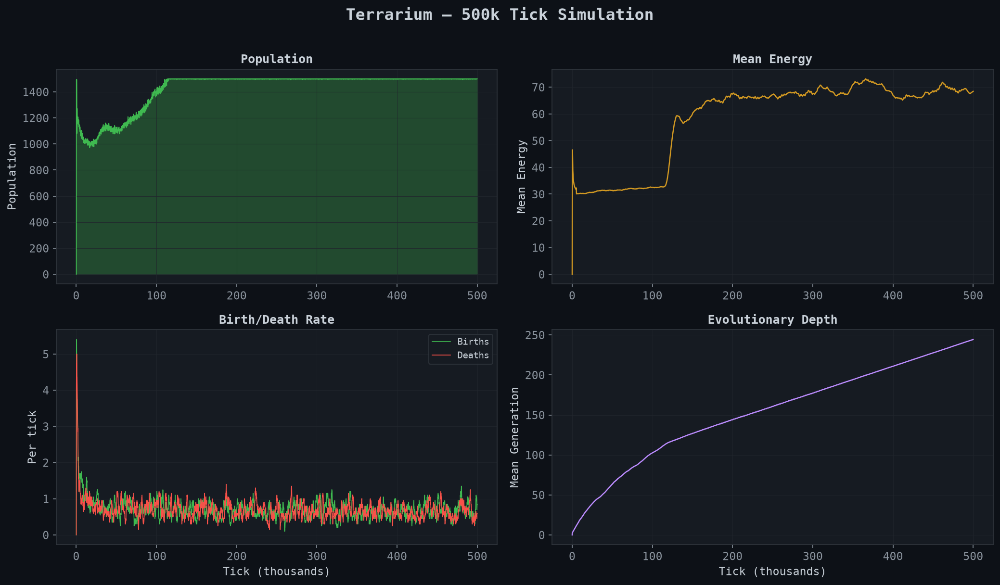
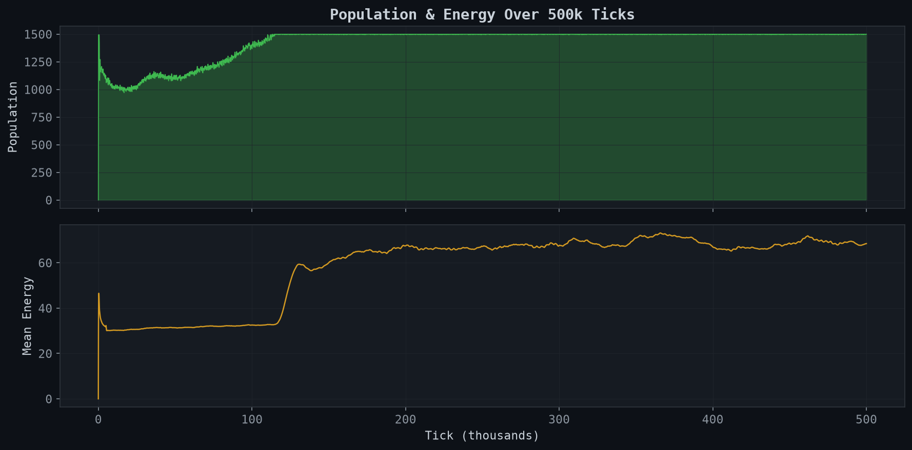
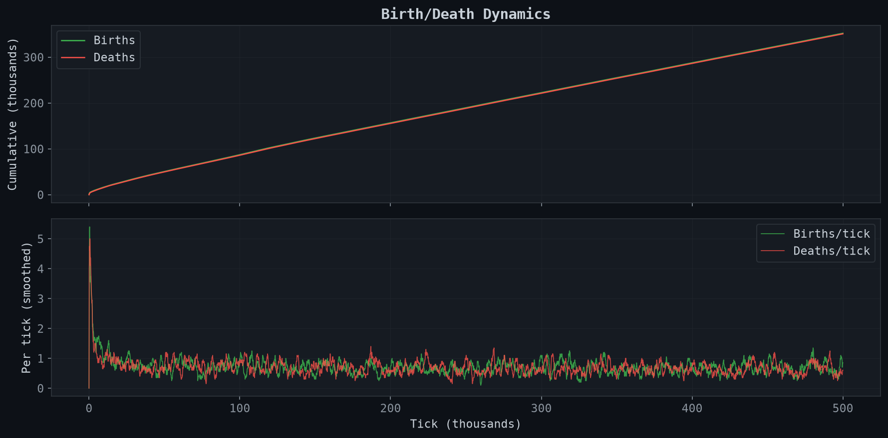
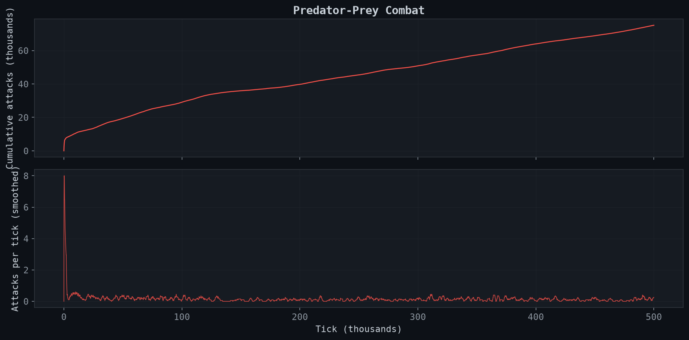
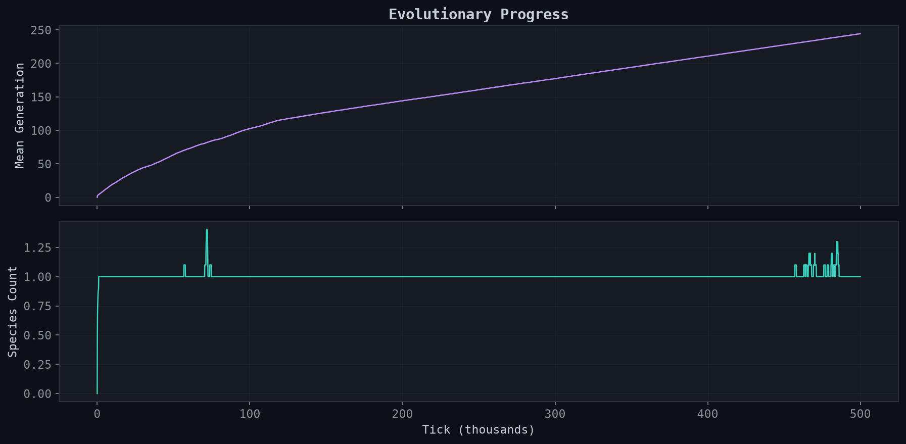

# Terrarium

**A digital terrarium where tiny creatures evolve brains, hunt each other, and speciate.**



Terrarium is a sealed digital world where creatures with small evolvable neural networks live, compete, cooperate, and evolve — while you set only the conditions. Run one jar and watch evolution unfold, or run thousands headless to answer a research question with data.

> **Core question:** What environmental conditions — scarcity, predation, group living — make larger brains and cooperation evolve?

## What's happening in there

Each creature has a **body** (position, energy, age, body size), **senses** (5 vision rays, own energy, nearby signals), and a **brain** (14-input feed-forward neural net whose weights are inherited and mutated). Every tick:

1. **Sense** — cast vision rays to detect food and other creatures
2. **Think** — run the neural network to decide: turn, speed, eat, attack
3. **Act** — move, consume food, pay metabolic costs (Kleiber's law scaling)
4. **Fight** — attack nearby creatures for energy (50% trophic transfer efficiency)
5. **Reproduce** — if energy exceeds threshold, spawn a mutated offspring
6. **Age** — Gompertz-Makeham mortality: death probability rises exponentially with age

Intelligence has a price: every neuron costs energy per tick. Bigger brains must earn their keep.

## Simulation Results

Data from a 500,000-tick run on Raspberry Pi 5 (seed=42, default config).

### Population & Energy Dynamics



Population stabilizes around the hard cap (~1500) with mean energy ~68. The ecosystem reaches equilibrium where births match deaths — a self-regulating system with no external control.

### Birth/Death Dynamics



~352k total births over 500k ticks — massive evolutionary churn. Birth and death rates track each other tightly after the initial transient, indicating a stable ecosystem.

### Predator-Prey Combat



~75k attacks over the run. Attack rate starts high as random brain weights produce aggressive behavior, then drops as evolution selects for more efficient foraging strategies. Combat persists at a low background rate — predation remains viable but isn't dominant.

### Evolutionary Progress



Mean generation reaches ~244 by tick 500k — roughly one generation every ~2000 ticks. Species count stays near 1 with brief speciation events, suggesting high gene flow prevents lasting divergence at this population density.

## Key Metrics

| Metric | Value |
|--------|-------|
| Population equilibrium | ~1500 (at hard cap) |
| Mean energy | ~68 |
| Total births (500k ticks) | 352,103 |
| Total attacks | 75,120 |
| Mean generation depth | 244 |
| Simulation speed | ~670 ticks/s (Pi 5), ~4400 ticks/s (M-series Mac) |
| Deterministic | Same seed = same run (ChaCha8Rng) |

## Architecture

```
sim-core       Headless simulation engine — world, organisms, genome, brain, rules
sim-viewer     macroquad + egui visual viewer (native + future WASM)
sim-runner     Headless CLI for experiments — single runs and parallel parameter sweeps
```

The viewer and the runner call the same `sim-core`, so a run watched live and a run in an experiment follow identical rules for the same seed.

## Quickstart

### Requirements

- [Rust](https://rustup.rs/) (stable)

### Watch the simulation

```bash
cargo run -p sim-viewer --release
```

Controls: **scroll** to zoom, **right-drag** to pan, **space** to pause, **click** a creature to inspect it.

### Run a headless experiment

```bash
# Single run — 100k ticks, log stats every 100 ticks
cargo run -p sim-runner --release -- \
  --config configs/default.toml \
  --ticks 100000

# Parameter sweep — vary food scarcity across 30 seeds per setting
cargo run -p sim-runner --release -- sweep \
  --config configs/default.toml \
  --param food.regrowth_rate \
  --values 0.0005,0.001,0.002,0.005,0.01 \
  --seeds 30 \
  --ticks 100000
```

Results land in `output/` as CSV files with a copy of the config for full reproducibility.

### Generate plots

```bash
python3 -m venv analysis/.venv
source analysis/.venv/bin/activate
pip install matplotlib pandas
python analysis/plot_readme.py output/stats_seed42.csv
```

## Biology & Citations

Every mechanic is backed by research:

| Mechanic | Model | Citation |
|----------|-------|----------|
| Mortality | Gompertz-Makeham law: h(age) = lambda + alpha * exp(beta * age) | Gompertz (1825), Williams (1957), Kirkwood (1977) |
| Metabolism | Kleiber's law: metabolic rate ~ body_mass^0.75 | Kleiber (1932) |
| Combat | Lotka-Volterra predator-prey with trophic efficiency loss | Lotka (1925), Volterra (1926) |
| Trophic levels | Energy source tracking (food vs predation) | Lindeman (1942) |
| Speciation | NEAT-style genome compatibility distance clustering | Stanley & Miikkulainen (2002) |
| Intelligence cost | Brain cost per neuron per tick (~20% metabolic budget in nature) | Aiello & Wheeler (1995) |
| World topology | Toroidal (no edge effects) | Durrett & Levin (1994) |

## Configuration

Every tunable number lives in one TOML file — no magic constants in the code:

```bash
cp configs/default.toml configs/my_experiment.toml
cargo run -p sim-viewer --release -- configs/my_experiment.toml
```

Key parameters:

| Group | Parameter | Default | What it does |
|-------|-----------|---------|-------------|
| Food | `regrowth_rate` | 0.0015 | How fast food grows back — controls scarcity |
| Energy | `brain_cost` | 0.002/neuron/tick | The intelligence tax |
| Energy | `base_metabolism` | 0.2/tick | Cost of staying alive |
| Reproduction | `threshold` | 60 | Energy needed to reproduce |
| Combat | `attack_damage` | 20 | Base damage per attack hit |
| Combat | `energy_transfer_ratio` | 0.5 | Trophic efficiency (50%) |
| Aging | `aging_rate` | 0.002 | Gompertz beta (evolvable) |

See [`configs/default.toml`](configs/default.toml) for the full list with comments.

## Project Structure

```
terrarium/
├── crates/
│   ├── sim-core/          # World, organisms, genome, brain, tick loop
│   │   ├── src/
│   │   │   ├── config.rs  # Typed config from TOML with validation
│   │   │   ├── world.rs   # Food grid, spatial hash (counting-sort), wraparound math
│   │   │   ├── organism.rs # Body, senses, lineage tracking
│   │   │   ├── genome.rs  # Heritable traits, evolvable mutation rate, genome distance
│   │   │   ├── brain.rs   # Feed-forward neural net (14→8→4), fast approximate tanh
│   │   │   └── sim.rs     # Deterministic tick loop with rayon parallelism
│   │   └── tests/         # 13 integration tests
│   ├── sim-viewer/        # macroquad + egui visual app
│   └── sim-runner/        # Headless CLI with parallel sweeps (rayon)
├── configs/               # TOML experiment configs
├── analysis/              # Python plot scripts
├── docs/                  # Design doc, progress tracker, plot images
└── output/                # Generated CSV/TOML from runs (gitignored)
```

## Roadmap

- [x] Core simulation engine (world, food, organisms, brain, genome)
- [x] Visual viewer with egui controls and organism inspector
- [x] Headless runner with CSV logging and parallel parameter sweeps
- [x] Performance: rayon within-tick parallelism, fast tanh (~4400 ticks/s)
- [x] Gompertz-Makeham probabilistic mortality (evolvable aging rate)
- [x] Predator-prey combat mechanics
- [x] Evolvable body size (Kleiber's law metabolism scaling)
- [x] Speciation detection and lineage tracking
- [x] Trophic level analysis
- [x] CI pipeline (tests, clippy, fmt, WASM build check)
- [ ] Social layer: broadcast signals, energy sharing, kin recognition
- [ ] NEAT-style brain topology evolution
- [ ] WASM build + GitHub Pages live demo
- [ ] Python analysis pipeline for experiment plots

## License

[MIT](LICENSE)
