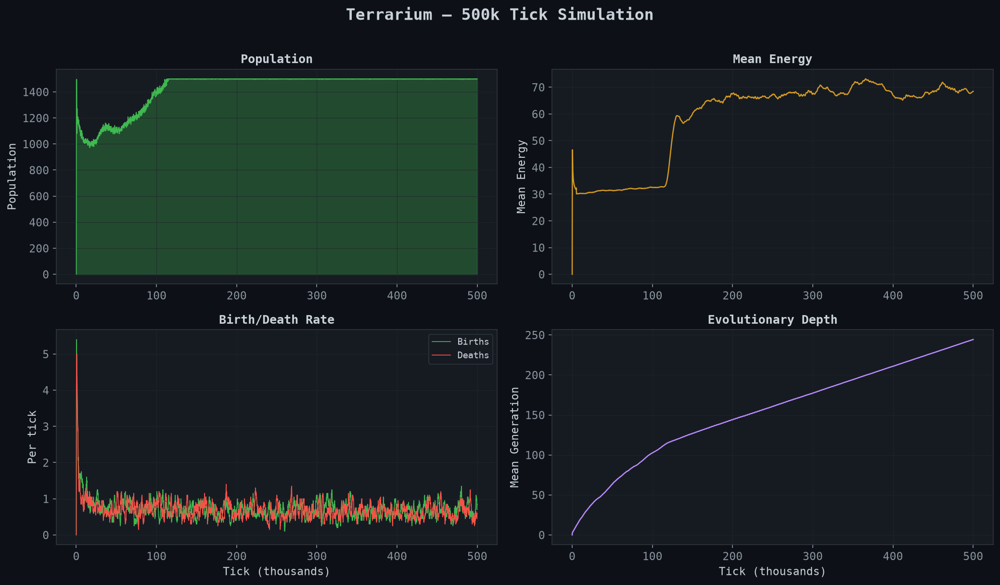
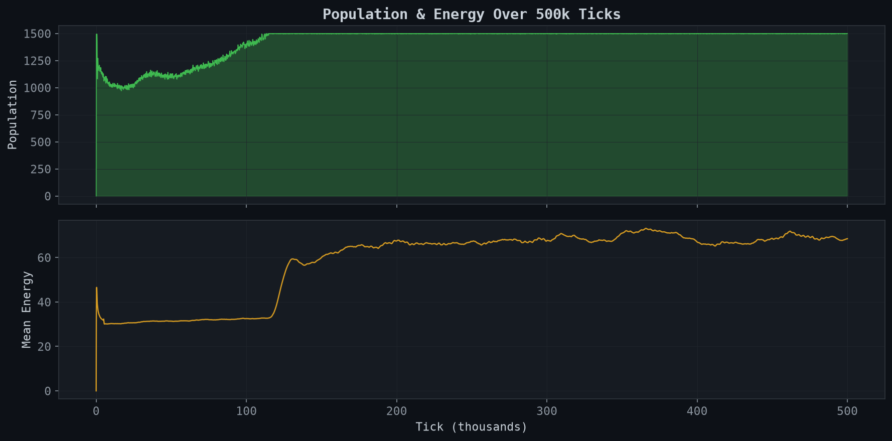
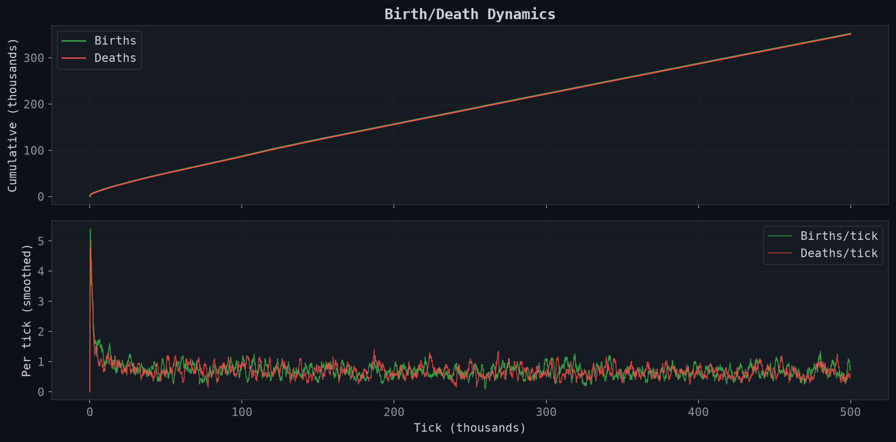
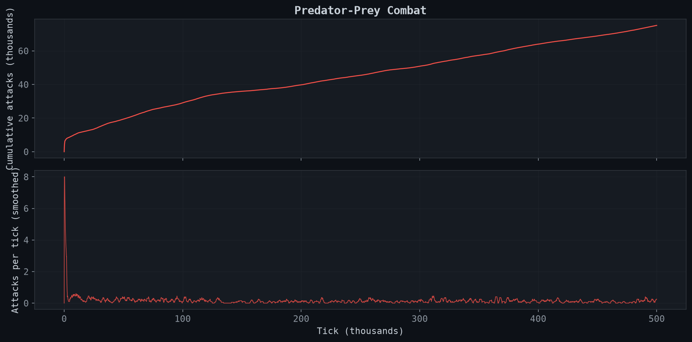
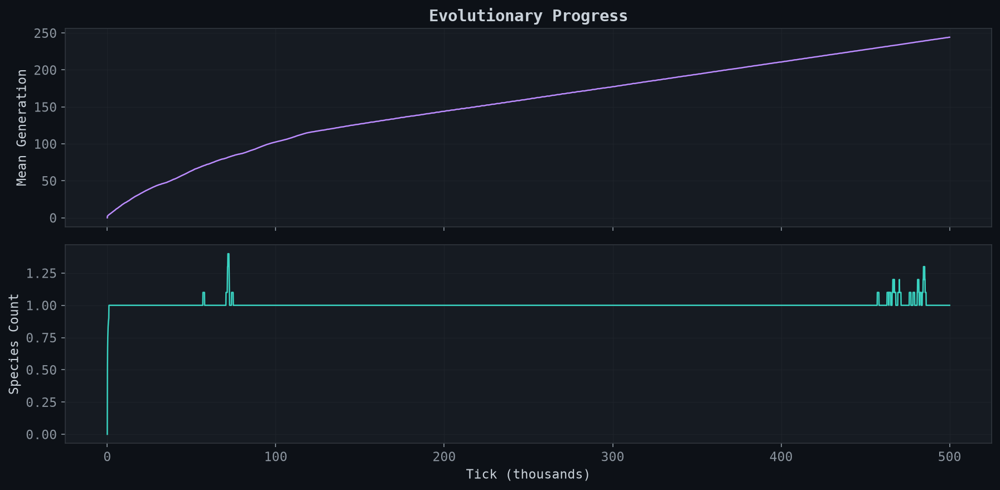
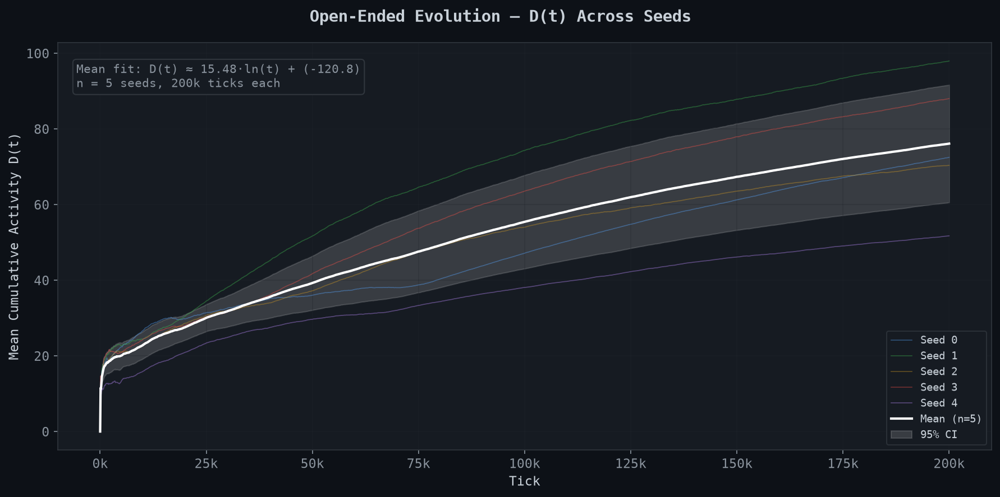
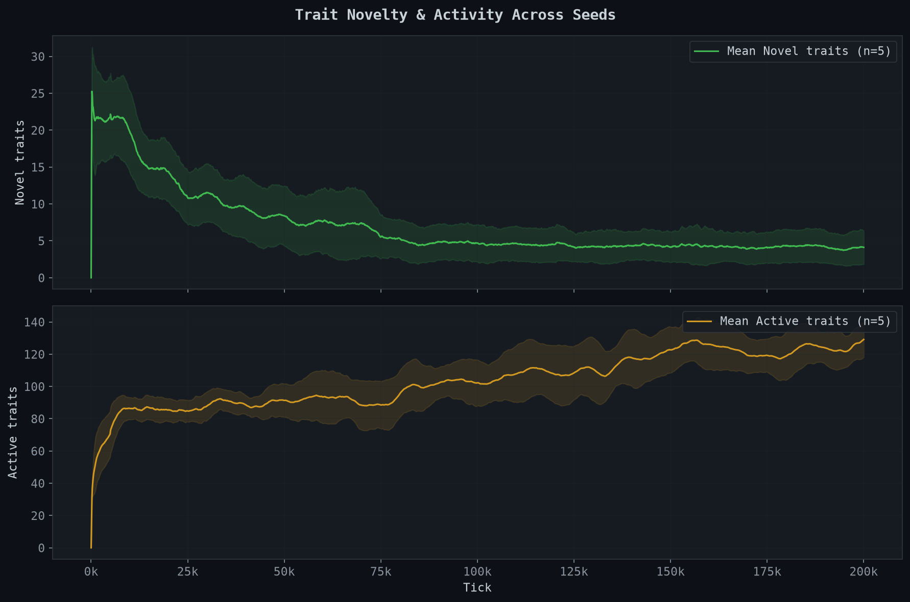

# Terrarium

**A digital terrarium where creatures evolve neural-net brains, hunt, cooperate, and speciate — driven entirely by physics and natural selection.**

[**Live Demo**](https://dchavan2192.github.io/Digital-Terrarium/) (runs in your browser — every visit is a unique simulation)



Terrarium is a sealed 2D world where creatures with evolvable NEAT neural networks live, compete, share energy with kin, and speciate — while you set only the environmental conditions. Run one jar and watch evolution unfold, or run thousands headless to answer a research question with data.

> **Core question:** What environmental conditions — food scarcity, predation pressure, brain cost — make cooperation, intelligence, and speciation evolve?

## What's happening in there

Each creature has a **body** (position, energy, age, evolvable body size), **senses** (5 vision rays, own energy, nearby signals, kin similarity, pheromone trails, temperature, light level, niche construction level), and a **brain** (NEAT-topology neural network — 19 inputs, variable hidden nodes, 7 outputs — whose structure and weights are inherited and mutated). Every tick:

1. **Sense** — cast vision rays to detect food and creatures; hear nearby broadcast signals; recognize kin by color hue similarity; sense pheromone trails, temperature, light level, and local niche construction
2. **Think** — run the neural network to decide: turn, speed, eat, attack, signal, share, construct
3. **Act** — move (speed scales inversely with body size), consume food, pay metabolic costs (Kleiber's law scaling)
4. **Fight** — attack nearby creatures for energy (50% trophic transfer, damage scales with body size)
5. **Share** — voluntarily transfer energy to nearest neighbor (kin selection drives this behavior)
6. **Construct** — deposit or degrade environmental material that modifies local food regrowth (niche construction)
7. **Reproduce** — sexual reproduction with NEAT crossover (find mate nearby, gene alignment) or asexual fallback; epigenetic methylation inherited with noise
8. **Age** — Gompertz-Makeham mortality: death probability rises exponentially with age (evolvable aging rate)
9. **Adapt** — under stress (low energy), connections accumulate methylation that silences them; offspring inherit this epigenetic state

Intelligence has a price: brain cost = structure maintenance + activity-dependent signaling (Attwell & Laughlin 2001). Bigger brains must earn their keep. Food availability oscillates seasonally. Spatial biomes, elevation terrain, pheromone trails, and organism-constructed environments create a rich ecological landscape that drives adaptive radiation.

## Simulation Results

Data from a 500,000-tick run on Raspberry Pi 5 (seed=42, default config).

### Population & Energy Dynamics



Population stabilizes around the hard cap (~1500) with mean energy ~68. The ecosystem reaches equilibrium where births match deaths — a self-regulating system with no external control.

### Birth/Death Dynamics



~352k total births over 500k ticks — massive evolutionary churn. Birth and death rates track each other tightly after the initial transient, indicating a stable ecosystem.

### Predator-Prey Combat



~75k attacks over the run. Attack rate starts high as random brain weights produce aggressive behavior, then drops as evolution selects for more efficient foraging strategies. Combat persists at a low background rate — predation remains viable but isn't dominant.

### Evolutionary Progress



Mean generation reaches ~244 by tick 500k — roughly one generation every ~2000 ticks.

### Open-Ended Evolution (OEE)



*Preliminary.* In 5 independent seeds (200k ticks each), cumulative evolutionary activity grew roughly as **~15.5·ln(t)**, with positive log coefficients (10–22) in every seed. This is consistent with ongoing novelty, but it is **not yet evidence of open-ended evolution**. Neutral drift also accumulates activity, so these runs must be compared against a neutral shadow model (Bedau, Snyder & Packard 1998), which is in progress. These runs also predate a fix to the activity metric (it averaged over extinct topologies too), so the numbers will be re-measured.



Novel topologies kept appearing throughout these runs, with ~130 active topologies at steady state.

| Metric | Value (n=5 seeds) |
|--------|-------------------|
| D(t) fit | 15.48·ln(t) − 120.8 |
| Final D(t) | 76.1 ± 17.8 |
| Active traits | 130.4 ± 7.7 |
| Max generation | 184.2 ± 44.0 |
| All populations survived | ✓ |

## Key Metrics

| Metric | Value |
|--------|-------|
| Population equilibrium | ~1500 (at hard cap) |
| Mean energy | ~68 |
| Total births (500k ticks) | 352,103 |
| Total attacks | 75,120 |
| Mean generation depth | 244 |
| Simulation speed | ~270 ticks/s (Pi 5), ~4400 ticks/s (M-series Mac) |
| Deterministic | Same seed = same run (ChaCha8Rng) |

## Architecture

```
sim-core       Headless simulation engine — world, organisms, NEAT genome, brain, tick loop
sim-viewer     macroquad + egui visual viewer (native + WASM live demo)
sim-runner     Headless CLI for experiments — single runs and parallel parameter sweeps
```

The viewer and the runner call the same `sim-core`, so a run watched live and a run in an experiment follow identical rules for the same seed.

## Quickstart

### Requirements

- [Rust](https://rustup.rs/) (stable)

### Watch the simulation

```bash
cargo run -p sim-viewer --release
```

Controls: **scroll** to zoom, **right-drag** to pan, **space** to pause, **click** a creature to inspect it.

### Run a headless experiment

```bash
# Single run — 100k ticks, log stats every 100 ticks
cargo run -p sim-runner --release -- \
  --config configs/default.toml \
  --ticks 100000

# Parameter sweep — vary food scarcity across 5 seeds per setting
cargo run -p sim-runner --release -- sweep \
  --config configs/default.toml \
  --param food.regrowth_rate \
  --values 0.0005,0.001,0.0015,0.002,0.003 \
  --seeds 5 \
  --ticks 200000
```

Results land in `output/` as CSV files with a copy of the config for full reproducibility.

### Generate plots

```bash
python3 -m venv analysis/.venv
source analysis/.venv/bin/activate
pip install matplotlib pandas scipy

# Single-run plots
python analysis/plot_readme.py output/stats_seed42.csv

# Experiment analysis (fetches data from Pi if --remote given)
python analysis/analyze_experiments.py --remote pi@100.127.61.93
```

## Biology & Citations

Every mechanic is backed by research:

| Mechanic | Model | Citation |
|----------|-------|----------|
| Mortality | Gompertz-Makeham law: h(age) = λ + α·exp(β·age) | Gompertz (1825), Williams (1957), Kirkwood (1977) |
| Metabolism | Kleiber's law: metabolic rate ~ body_mass^0.75 | Kleiber (1932) |
| Brain cost | Structure + activity-dependent: Σ\|weight × activation\| | Attwell & Laughlin (2001) |
| Combat | Lotka-Volterra predator-prey with trophic efficiency loss | Lotka (1925), Volterra (1926) |
| Trophic levels | Energy source tracking (food vs predation) | Lindeman (1942) |
| Speciation | NEAT-style genome compatibility distance with dynamic threshold | Stanley & Miikkulainen (2002) |
| Brain evolution | NEAT: topology + weight evolution via add-node/add-connection | Stanley & Miikkulainen (2002) |
| Sexual reproduction | NEAT crossover: gene alignment on (from,to) keys | Maynard Smith (1978), Muller (1932) |
| Kin recognition | Color hue similarity as kin marker; enables rB > C altruism | Hamilton (1964) |
| Cooperation | Voluntary energy sharing with nearest neighbor | Trivers (1971) |
| Niche construction | Organisms modify local food regrowth (ecological inheritance) | Odling-Smee et al. (2003), Laland et al. (1999) |
| Epigenetic inheritance | Stress-responsive methylation, heritable with noise | Jablonka & Lamb (2005), Heard & Martienssen (2014) |
| OEE metrics | Topology hashing, cumulative activity D(t), lineage diversity | Bedau & Packard (1991), Dolson et al. (2019) |
| Pheromone trails | Stigmergic communication via chemical deposition/decay | Wilson (1975), Deneubourg et al. (1990) |
| Elevation terrain | Multi-octave sine height field, slope movement penalty | MacArthur & Wilson (1967), Wright (1943) |
| Day/night cycle | Sinusoidal light oscillation, vision halved at night | Kronfeld-Schor & Dayan (2003) |
| Density pressure | Per-neighbor metabolic cost (interference competition) | Allee (1931) |
| Seasonal cycles | Sinusoidal food regrowth oscillation | Botkin (1990) |
| Spatial niches | Circular biome zones with regrowth multipliers | Schluter (2000), Rosenzweig (1995) |
| Brain entropy | Shannon entropy of output activation histograms | Shannon (1948), Beer & Williams (2015) |
| World topology | Toroidal (no edge effects) | Durrett & Levin (1994) |

## Configuration

Every tunable number lives in one TOML file — no magic constants in the code:

```bash
cp configs/default.toml configs/my_experiment.toml
cargo run -p sim-viewer --release -- configs/my_experiment.toml
```

Key parameters:

| Group | Parameter | Default | What it does |
|-------|-----------|---------|-------------|
| Food | `regrowth_rate` | 0.0015 | How fast food grows back — controls scarcity |
| Food | `seasons.amplitude` | 0.3 | Seasonal boom/bust (0 = no seasons) |
| Energy | `brain_cost` | 0.002/neuron/tick | The intelligence tax |
| Energy | `base_metabolism` | 0.2/tick | Cost of staying alive |
| Reproduction | `threshold` | 60 | Energy needed to reproduce |
| Combat | `attack_damage` | 20 | Base damage per attack hit |
| Combat | `energy_transfer_ratio` | 0.5 | Trophic efficiency (50%) |
| Sharing | `share_amount` | 5 | Energy transferred per share action |
| Aging | `aging_rate` | 0.002 | Gompertz beta (evolvable) |
| Density | `cost_per_neighbor` | 0.01 | Crowding metabolic penalty |

See [`configs/default.toml`](configs/default.toml) for the full list with comments.

## Project Structure

```
terrarium/
├── crates/
│   ├── sim-core/          # World, organisms, NEAT genome, brain, tick loop
│   │   ├── src/
│   │   │   ├── config.rs  # Typed config from TOML with validation
│   │   │   ├── world.rs   # Food grid, spatial hash (counting-sort), biomes, seasons
│   │   │   ├── organism.rs # Body, senses, entropy tracking
│   │   │   ├── genome.rs  # NEAT genome: connections, hidden nodes, traits, distance
│   │   │   ├── brain.rs   # NEAT feed-forward net, stack-allocated forward pass
│   │   │   └── sim.rs     # Deterministic tick loop, species clustering, stats
│   │   └── tests/         # 30 tests (26 integration + 3 activity + 1 doctest)
│   ├── sim-viewer/        # macroquad + egui visual app (native + WASM)
│   └── sim-runner/        # Headless CLI with parallel sweeps (rayon)
├── configs/               # TOML experiment configs
├── analysis/              # Python analysis and plot scripts
├── web/                   # WASM host page for GitHub Pages
├── docs/                  # Design doc, progress tracker, plot images
└── output/                # Generated CSV/TOML from runs (gitignored)
```

## Roadmap

- [x] Core simulation engine (world, food, organisms, brain, genome)
- [x] Visual viewer with egui controls and organism inspector
- [x] Headless runner with CSV logging and parallel parameter sweeps
- [x] Performance: rayon within-tick parallelism, fast tanh (~4400 ticks/s)
- [x] Gompertz-Makeham probabilistic mortality (evolvable aging rate)
- [x] Predator-prey combat with size-scaled damage
- [x] Evolvable body size (Kleiber's law metabolism scaling)
- [x] NEAT-style brain topology evolution (add-node, add-connection mutations)
- [x] Social layer: broadcast signals, energy sharing, kin recognition
- [x] Speciation detection with dynamic compatibility threshold
- [x] Per-species stats panel in viewer (population, trends, trophic, traits)
- [x] Trophic level analysis and brain entropy metrics
- [x] Seasonal food cycles and spatial biome zones
- [x] Density-dependent competition (Allee effect)
- [x] Pheromone trails (stigmergic communication)
- [x] Elevation terrain with slope movement penalty
- [x] Day/night cycle with reduced vision at night
- [x] Activity-dependent brain metabolism (Attwell & Laughlin 2001)
- [x] Sexual reproduction with NEAT crossover (Maynard Smith 1978)
- [x] Open-ended evolution metrics: D(t), topology novelty, lineage diversity (Bedau & Packard 1991)
- [x] Niche construction: organisms modify local food regrowth (Odling-Smee et al. 2003)
- [x] Epigenetic inheritance: stress-responsive methylation (Jablonka & Lamb 2005)
- [x] WASM build + GitHub Pages live demo (unique seed per visit)
- [x] CI pipeline (tests, clippy, fmt, WASM build)
- [ ] Experiment analysis: cooperation, food scarcity, brain cost sweeps (in progress)
- [ ] Python analysis pipeline with publication-quality figures
- [ ] Parameter tuning for long-term ecosystem stability

## License

[MIT](LICENSE)
