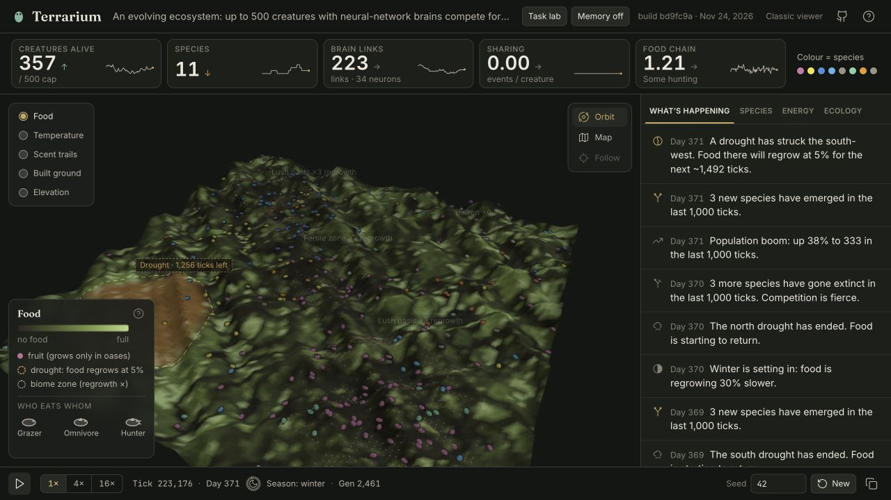

# Digital Terrarium

Watch creatures forage, compete and reproduce in a world where movement and neural processing cost energy. Each creature inherits a neural controller. The same Rust simulation powers an interactive browser world and a headless experiment runner.

**[Explore the live terrarium](https://dchavan2192.github.io/Digital-Terrarium/demo/)** · [Research results](docs/RESULTS.md) · [Reproduce an experiment](#reproduce-an-experiment)

[](https://dchavan2192.github.io/Digital-Terrarium/demo/?seed=42)

*Seed 42, tick 223,176. The food layer shows where algae can sustain the population. The shaded southeast patch is experiencing a drought. Captured from the live browser demo at revision `bd9fc9a`.*

## Try the demo

- **Follow a creature.** Pause, select a creature, and inspect its controller. Switch between the food and temperature layers to see the conditions around it.
- **Replay a world.** Enter a seed to restart. The **Memory** switch starts a new world in which recurrent connections can evolve. A recurrent connection can carry an earlier activation into the next decision.
- **Open Task lab.** Watch recorded cue-following trials and explore the offspring counts from the memory studies. The live world has changing resources and interacting creatures. Task lab shows controlled experiments where food deliveries and cue timing can be matched.

## What the memory experiments found

Could remembering a brief cue help a creature leave more offspring? A founder saw a cue, waited through a delay and chose where to move. Food appeared **after** that choice. We compared the same controller with its memory intact and cleared, and repeated the experiment with shuffled cues while keeping food deliveries identical.

| Question | Result |
|---|---|
| Can memory pay off when food is within reach? | Three controllers selected for sustained recall each produced **8 offspring with reliable cues and 4 after memory was cleared** at the closest distance. At the original distance, none gained offspring over its reset control. [Distance experiment](docs/results/FOOD_CUE_DISTANCE.md) |
| How common was the benefit? | Among the other 31 founding populations in the original wiring study, **1 gained offspring, 20 tied and 10 lost offspring** with memory intact at the close distance. [Population study and raw data](docs/results/FOOD_CUE_POPULATION.md) |
| What did direct selection for offspring favor? | Across eight new founding populations, the winning strategy was to choose one side and eat there. Winners averaged **3.81 offspring** on fresh schedules, versus **1** for turn-selected winners. Clearing memory left their birth counts unchanged. [Four-way selection experiment](docs/results/FOOD_CUE_SELECTION.md) |

**The one-step food-cue series is complete.** Giving equally successful descendants more chances to reproduce preserved recurrent connections. Some circuits retained a weak cue signal, but removing their default turn still produced no descendants meeting the established turn-strength benchmark in both directions. These findings apply to this arena, its controllers and its training regimes. Whether memory improves fitness in the open ecosystem remains an open question. [Tie-breaking study](docs/results/FOOD_CUE_TIES.md) · [Final diagnostic](docs/results/FOOD_CUE_BLANK_TURN.md)

## Run locally

The browser demo needs no installation. For native use, install stable Rust and run these commands from the repository root. On Ubuntu the native viewer also requires `libasound2-dev`. [Rust installation](https://rustup.rs/)

```sh
# Run 1,000 simulation ticks and write statistics to a new session directory.
cargo run --release -p sim-runner -- --config configs/default.toml --ticks 1000 --output output/smoke

# Open the native viewer.
cargo run --release -p sim-viewer
```

### Reproduce an experiment

This Python 3 diagnostic replays saved genomes from the checked-in archive. It verifies the original archive checksum and writes per-controller results as JSON. It uses the Python standard library.

```sh
mkdir -p output
python3 analysis/food_cue_blank_turn.py > output/blank-turn.json
```

To run a new native memory experiment, replay the fixed cohort at all four starting distances. Use a fresh output directory. The report links the archived results and explains how the controls are audited. [Protocol and expected outcomes](docs/results/FOOD_CUE_DISTANCE.md)

```sh
cargo build --release -p sim-runner
RAYON_NUM_THREADS=1 python3 analysis/run_food_cue_distance.py --output output/my-distance-study
```

## Inside the simulator

The landscape wraps at its edges. Algae, fruit, seasons, droughts and terrain affect what a creature can reach and eat. Five vision rays contribute to a 20-input controller with seven actions. Creatures can turn, move, eat, attack, signal, share and construct. Weights, connections, hidden nodes and body traits can mutate. The engine supports sexual reproduction through crossover, inherited methylation and local changes to food regrowth.

| Component | Where to look |
|---|---|
| World dynamics, energy accounting, neural controllers and inheritance | [sim-core](crates/sim-core) |
| Headless runs, checkpoints, parameter sweeps and controlled tasks | [sim-runner](crates/sim-runner) |
| Browser viewer and WebAssembly bridge | [web/demo](web/demo) · [sim-wasm](crates/sim-wasm) |
| Native viewer | [sim-viewer](crates/sim-viewer) |
| Model parameters, analysis and replication scripts | [Default config](configs/default.toml) · [Demo config](configs/demo.toml) · [analysis](analysis) |

For provenance, start with the [results register](docs/RESULTS.md). It also records pinned-engine calibration runs and withdrawn historical claims, including an early cooperation estimate affected by an energy-accounting bug. The [development history](docs/PROGRESS.md) preserves the experiments in order of recency. The [ecology review](docs/research/FOOD_CUE_ECOLOGY_REVIEW.md) explains why turning, reaching food, eating and reproducing were measured separately.

## License

[MIT](LICENSE)
