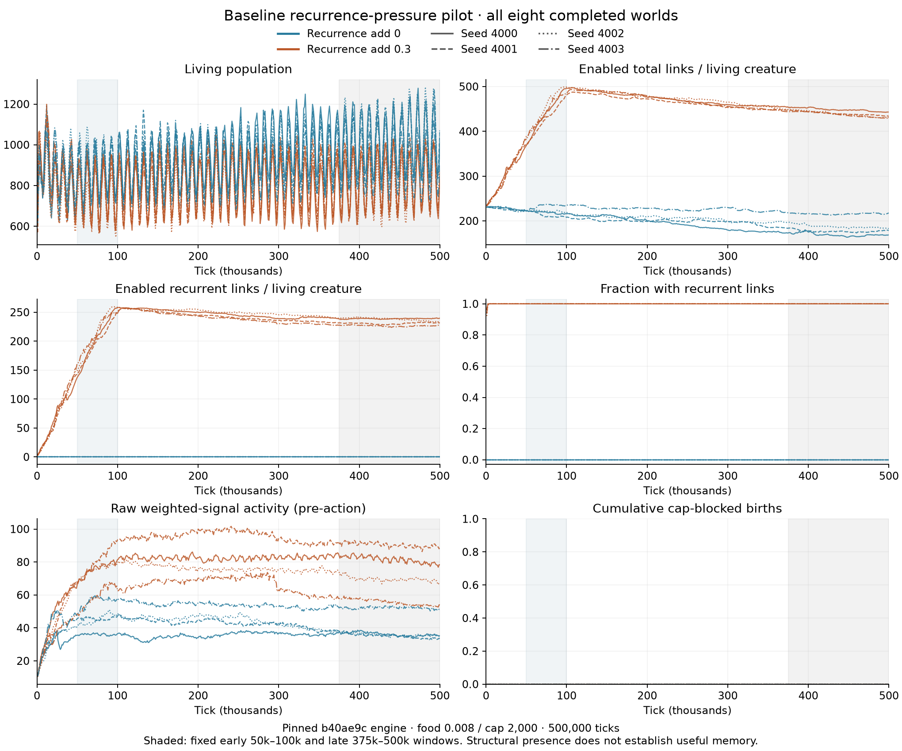

# Completed baseline recurrence-pressure pilot — audited 2026-11-22

All eight prescribed worlds completed 500,000 ticks on 2026-11-18, with no extinction or technical failure. At baseline food regrowth0.008 and cap2000, recurrence-on worlds had more enabled neural connections and lower late-window populations in all four seed pairs. No birth was blocked by the cap in any world. This is an exploratory structural/demographic contrast between recurrence-add mutation probabilities0 and0.3, not evidence that organisms used or benefited from memory.

The [prospective plan](BASELINE_RECURRENCE_LONG_PLAN_2026-11-17.md) fixed four paired seeds4000–4003, balanced arm order, one serial worker/thread and the500k horizon before outcomes. All8/8 worlds and4/4 pairs are retained. The [full audited JSON](baseline_recurrence_long_2026-11-22.json) contains trajectories, exact early/late/final metrics, event windows, source checks and consumed-artifact hashes. Raw noncheckpoint artifacts were mirrored from Pi campaign `output/long_recurrence/baseline_long_20261118T023800Z`; checkpoints remain preserved on Pi.



[Raw dataset and reproduction assets](https://github.com/dchavan2192/Digital-Terrarium/releases/tag/baseline-long-recurrence-2026-11-22) include the pinned executables, full final populations, configurations, CSVs, supervision and thermal records. Checkpoints remain on the Pi and are excluded from this archive.

## Pinned scope and audit

This experiment used clean native engine `b40ae9c15ef5f90f17e7e2bbbc286c1c19c0b88c`, core build `297edc68fb18e05e`, release target `aarch64-unknown-linux-gnu`, executable SHA-256 `05e6fe23121818fb897332a53f314da11e2ea98fed6f61cfe52d607009833e63`. Whole baseline configuration SHA-256 is `bcfd543bc75ed4127389c17c24e6282a8e735c96a903d0a55abd6e0fd165079d`; copied worker SHA-256 is `0f0d0953b5feedb951b949729adc7d5504ce3506dca5445f9bc5eb99edc729ae`. The only per-job ecological configuration differences are seed and assigned recurrence-add probability. Native source-clean metadata, whole effective configurations, per-job copied input hashes and final export identities match the frozen campaign.

An independent raw-artifact audit recomputed all eight summaries and agrees with the strict auditor. Each world has exactly500 ordered CSV snapshots at ticks1000..500000,51 early-window observations at50000..100000 inclusive, and126 late observations at375000..500000 inclusive. Each final export's living record count, enabled total/recurrent connection means and recurrence fraction match the final CSV. Every runner, guard and supervisor exited0, and each final guard reports no paused or matching runner. Campaign worker completed all eight jobs in the declared order.

The newer upstream diet/resource/neutral-shadow changes, including source `2e28f08`, were absent from this pinned executable. They change ecological rules and activity-metric semantics. These results do not validate those new defaults or the new shadow implementation, and cannot be recomputed by silently substituting the current engine.

## Frozen late-window outcomes

Entries below are arithmetic means across each world's126 saved late ticks. Connections count enabled edges per post-update living organism. Recurrence fraction is0 in every off-arm late snapshot and1 in every on-arm late snapshot. Raw activity has a separate pre-action denominator and is not an energy measurement.

| Seed | Recurrence add | Population | Total links | Recurrent links | Raw activity |
|---|---:|---:|---:|---:|---:|
|4000|0|1016.905|169.306|0|36.214|
|4000|0.3|821.175|448.449|238.885|81.524|
|4001|0|998.944|177.125|0|35.121|
|4001|0.3|832.762|439.989|230.697|90.366|
|4002|0|1006.659|187.730|0|35.675|
|4002|0.3|798.984|439.151|238.189|69.636|
|4003|0|918.032|215.886|0|52.180|
|4003|0.3|838.675|437.429|226.482|55.679|

Equally weighted across the four worlds per arm, off/on late means are population985.135/822.899, total links187.512/441.254, recurrent links0/233.563, enabled feed-forward links187.512/207.691, and raw activity39.797/74.301. These are world-level descriptions, not pooled-organism estimates.

| Seed | On-minus-off population | On-minus-off total links | On-minus-off recurrent links | On-minus-off raw activity |
|---|---:|---:|---:|---:|
|4000|-195.730|279.142|238.885|45.310|
|4001|-166.183|262.865|230.697|55.245|
|4002|-207.675|251.421|238.189|33.961|
|4003|-79.357|221.543|226.482|3.499|
|Mean across4 pairs|-162.236|253.743|233.563|34.504|

The paired population contrast ranges from-207.675 to-79.357; total-link contrast221.543..279.142. Recurrent edges account for most of the between-arm total-edge contrast, but this decomposition does not identify the evolutionary mechanism.

## Early-to-late trajectories and final endpoints

The table reports late mean minus early mean using the two frozen windows. It is not a slope fit or a stationarity test. All four recurrence-on worlds increased their recurrent-edge mean, while their total-edge means increased in two and decreased in two. Mean on-arm total links changed only439.977→441.254 across these windows, while recurrent links changed207.396→233.563 and feed-forward links decreased. Off-arm total links declined in all four worlds (arm mean221.759→187.512). There is no consistent continuing total-link growth across all recurrence-on worlds and no unbounded-growth inference.

| Seed | Add probability | Δ population | Δ total links | Δ recurrent links | Final population | Final total links | Final recurrent links |
|---|---:|---:|---:|---:|---:|---:|---:|
|4000|0|189.297|-49.664|0|1011|168.215|0|
|4000|0.3|38.959|9.777|34.864|873|443.069|239.733|
|4001|0|119.219|-36.212|0|1064|178.416|0|
|4001|0.3|59.938|13.587|32.690|845|433.664|232.006|
|4002|0|117.149|-33.988|0|1073|182.897|0|
|4002|0.3|66.278|-12.550|24.734|863|431.380|233.419|
|4003|0|47.247|-17.125|0|905|217.722|0|
|4003|0.3|65.851|-5.705|12.380|820|429.285|226.961|

Late populations fluctuate substantially: off-arm within-world population standard deviations131.986,136.713,149.831,125.220; on-arm123.096,120.927,116.019,120.087, in seed order4000..4003. These use population SD over each saved window, not uncertainty across independent worlds. Across the full logged trajectories, off populations range599..1284 and on546..1199. All late saved populations are below1800 (90% of cap), and cumulative cap-blocked births remain exactly0 throughout all eight worlds. Thus the hard cap did not block reproduction in this campaign; sampled population values alone would not have established that.

Births and deaths are single-tick values in each CSV snapshot; their sums over saved rows would miss intervening events. Full-run totals and exact inclusive late-window event counts are retained in the JSON, using C(end)-C(start)+events_at_start. Every world has millions of births/deaths, and all corresponding cap-blocked counts are zero. Their turnover does not make organisms or ticks independent replicates.

## Thermal and execution record

Campaign execution ran2026-11-18 02:37:47.519056–21:07:24.827972 UTC (about18h30m). All jobs stayed within their six-hour startup/cooling-inclusive watchdogs. Per-job supervisor elapsed times were7285.393,10057.018,9585.389,6909.428,7008.315,9138.636,9421.223,7168.951 seconds in campaign order. No watchdog/resource/checkpoint failure was recorded.

The supervisor telemetry contains13,268 records, all with numeric temperature and parsed throttle flags, distributed1453,2004,1910,1377,1397,1821,1877,1429 per job. Sampled temperatures range55.65–76.55°C. Maximum observed gap between successive records within a job is5.382873 seconds. No sample has active low-bit throttle flags; historical flags remain recorded. The guard logged233 owned-runner pauses and233 resumes in total (25,54,30,20,19,30,34,21 per job), consistent with active75/65°C hysteresis. A sampled value above75°C is compatible with polling/control latency;75°C is a pause threshold, not a guaranteed maximum temperature.

These time series and clean final statuses establish sampled coverage and observed interventions. They do not rule out temperature peaks, brief throttle events or resource peaks between samples, and do not convert job-boundary disk/RAM checks into continuous monitoring. Checkpoints were not required for this noncheckpoint outcome audit; preserving them is distinct from validating their entire payload here.

## Interpretation

The finite-horizon comparison supports structural recurrence accumulation under the0.3-add setting and a lower late population relative to its paired0-add worlds in this engine/configuration. It extends the earlier demo-setting diagnostic to a baseline in which no cap-blocked births occurred, but differences between studies in environment, horizon and engine prevent a clean cross-study single-factor comparison.

Recurrence-add probability0.3 versus pruning0.02 creates asymmetric mutation pressure. Expression, turnover, drift, selection and demographic feedback can all contribute; this design does not partition them. Lower population does not by itself isolate neural energetic cost or prove maladaptive memory. Raw activity is weighted-signal magnitude; the separate energy ledger records realized costs. Recurrence presence is structural, not demonstrated retention, information use or task learning.

The independent unit is one evolutionary world, with four paired seed labels and diverging organism histories. This exploratory sample has no confirmatory significance, memory-benefit, equilibrium, generalization, intelligence, cooperation, UAL or OEE claim. No neutral shadow ran in these worlds. Even for a future validated shadow, finite-horizon activity above a conditional null would not alone establish unbounded novelty or a Channon class4b conclusion. Competence acquisition and controlled retention testing remain separate research steps; these outcomes do not authorize changing the ecological/demo fitness rules.

## Reproduce

```bash
python3 analysis/summarize_long_recurrence.py output/long-recurrence/baseline_long_20261118T023800Z --output output/long-recurrence/reproduced.json
MPLCONFIGDIR=output/long-recurrence/mpl-cache analysis/.venv/bin/python analysis/plot_long_recurrence.py docs/results/baseline_recurrence_long_2026-11-22.json output/long-recurrence/reproduced.png
python3 -m unittest discover -s analysis -p 'test_long_recurrence_summary.py'
```
