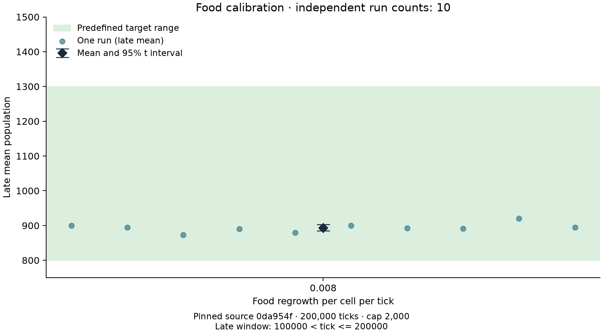

# Current-engine baseline recheck — completed 2026-11-17 UTC

Status: **all predefined engineering criteria passed**.
ID: CAL-2026-11-17-BASELINE.

The approved food rate 0.008 and population cap 2,000 passed the
[recheck plan](CURRENT_BASELINE_RECHECK_2026-11-16.md) on all ten seeds. This
confirms the selected setting against the finite-duration engineering gate
under pinned source 0da954f. It is not a new selection study, evidence of adaptive
memory, proof of equilibrium, or a multi-million-tick stability result.

| Predefined criterion | Observed | Pass |
|---|---|---|
| All ten seeds survive 200,000 ticks | 10/10 | Yes |
| Zero cap-blocked births | 0 in every seed | Yes |
| Across-seed late population mean 800–1,300 | 893.629 | Yes |
| No logged post-burn-in minimum below 200 | Lowest 620 | Yes |

Late mean population across runs was 893.629, sample SD
12.5436; exploratory 95% Student-t CI 884.656–902.602.
Run means ranged 872.900–920.175.
The run, not each snapshot or organism, is the independent unit. The interval
was added after execution and was not a selection criterion.



The largest logged population was 1,277, below cap 2,000. Maximum absolute
reserve-balance residual was 1.23598908885e-10. Mean late reserve
energy was 32.3636; mean active connections 215.0832.
Population rose from 872.586 in ticks 20,000–100,000 to
893.629 in ticks 100,500–200,000; connections declined in all
ten runs. Finite-run acceptance does not establish stationarity or adaptation.

## Provenance and independent audit

- Batch `/home/pi/Digital-Terrarium/output/phase9a/validation_20261116T171843Z_28985`,
  mirrored logs at `output/pi-validation/validation_20261116T171843Z_28985/`.
- Source `0da954fa2911e5a0f075375b41196f8dafa6e4c8`, release core
  `abad322241615ca2`, `aarch64-unknown-linux-gnu`,
  `rustc 1.99.1 (58cf8f9c3 2026-10-13)`. One worker/thread.
- Dirty-build flag is retained as true; source-status records only untracked
  `nohup.out` and `run_overnight.sh`. Full effective config is stored per run.
  Genotype innovation identity and independent drought RNG are included;
  recurrence is off and its metrics remain zero.
- Seeds 100–109 reused from the earlier calibration, not fresh held-out seeds.
  Each ran 200,000 ticks, logging every 500 and checkpointing every 50,000.
  Stats schema 3, checkpoint 4, manifest 2, topology hash 2. No resumed sessions,
  dropped runs, technical failures or extinctions.
- Independent audit recomputed all 30 CSV/configuration/manifest hashes and
  exactly 400 snapshots per seed (500..200,000), checked IDs/configs/status and
  reproduced all four criteria. The local strict summary equals the Pi's
  pinned finalizer output exactly.
- [Per-run results and hashes](current_baseline_recheck_2026-11-17.json),
  [exploratory ecology](current_baseline_ecology_2026-11-17.json).

Analysis scripts are unchanged from source `9d00b24`; the strict summarizer
SHA-256 is `ee7b52cd1a47d3a0c5b2beaf2fcb2e745e02f90a786b7186beda5f5500d80a9f`.

```bash
python3 analysis/summarize_validation.py output/pi-validation/validation_20261116T171843Z_28985 docs/results/current_baseline_recheck_2026-11-17.json
python3 analysis/analyze_validation_ecology.py output/pi-validation/validation_20261116T171843Z_28985 docs/results/current_baseline_ecology_2026-11-17.json
MPLCONFIGDIR=output/matplotlib analysis/.venv/bin/python analysis/plot_validation.py docs/results/current_baseline_recheck_2026-11-17.json docs/results/current_baseline_recheck_2026-11-17.png
```

The generic summarizer calls its rule "smallest acceptable rate", but only
one prespecified candidate was rechecked here; no new rate was selected.
The approved defaults stay 0.008/cap 2,000 and the demo remains separately tuned.

## Thermal operation and limits

Completed at approximately 02:15 UTC, 2026-11-17. The 537 minute-log samples
recorded maximum 75.7°C and no active low-bit throttling flags. The guard logged
149 pauses and 149 resumes, totaling 7,303 seconds paused (2.029 hours), with no
unmatched pause. Summed run elapsed time was 8.947 hours, including pauses.
The guard/finalizer exited normally; the Pi is idle. These are sampled operating
observations, not a hardware guarantee. Retain the guard for future sustained
work and improve cooling when possible.

The earlier source 2b1c837 setting averaged 913.917 at the same rate; this build
averaged 893.629 (−20.288, −2.22%). Multiple engine changes and unsynchronized old
versus new drought schedules prevent a single-mechanism causal interpretation.
The same-seed descriptive paired interval spans zero and does not establish
equivalence. The original broad roadmap's full ten-seed replication on a
second machine remains unmeasured; prior portability checks have narrower scope.

## Public raw-data archive

[Completed-baseline data and analysis scripts](https://github.com/dchavan2192/Digital-Terrarium/releases/tag/current-baseline-recheck-2026-11-17)
exclude checkpoints/executables and preserve all run logs/configurations,
metadata, finalizer summary and thermal records. All 30 recorded artifact
hashes were verified within the archive. Archive SHA-256:
`fc0832ad3a3f6499c7f6ddd1045f0d423ac7bc76f1f968b0a1885c77c0b4accb`.

## Next work

The finite-duration baseline gate now supports moving on with instrument
work. Complete the already planned visible-cue competence control, then assess
recurrent genotypes with matched state resets before interpreting memory
benefits. No additional evolutionary campaign is launched from this result.
