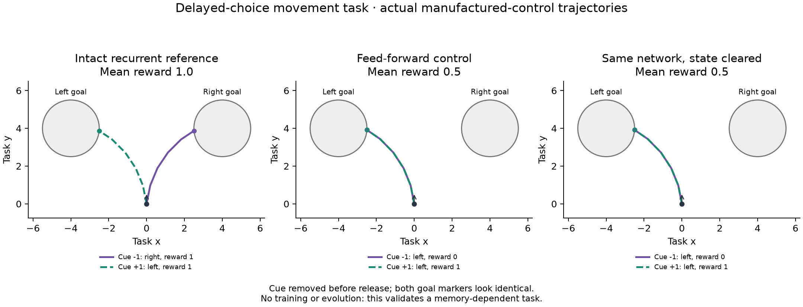

# Delayed-choice movement arena — 2026-11-16

Status: **instrument validation passed; no evolutionary memory claim**.
ID: CHK-2026-11-16-DELAYED-CHOICE-ARENA.

The controlled task holds position and heading while a signed cue is shown
and removed, then releases the controller toward two identical goal markers.
Only first contact reveals terminal reward. All task values are in
[the arena config](../../configs/delayed_choice.toml); the
[development protocol](DELAYED_CHOICE_ARENA_PLAN_2026-11-16.md) preceded the
actual evolved-donor evaluation. The positive reference was deliberately
manufactured to solve this task, not independently evolved or trained.

## Manufactured controls

| Controller | Negative cue | Positive cue | Mean reward |
|---|---|---|---|
| Recurrent reference | Right, correct | Left, correct | 1.0 |
| Same weights without recurrence | Left, wrong | Left, correct | 0.5 |
| Same recurrent network, state cleared each tick | Left, wrong | Left, correct | 0.5 |

All controls reached a goal in five movement ticks. No timeout was used to
produce a nominal chance score. Pose stays fixed during cue/delay; the first
decision inputs are identical across cues. Full response-phase inputs, actions
and poses match across opposite cues for the two no-memory controls. Thus
remembering the removed cue can improve reward in this specific controlled
movement task, as demonstrated by the fixed reference. There is no learning,
fitness selection or natural-world energy accounting here.



[Full manufactured-control traces](delayed_choice_controls_2026-11-16.json).

## Actual evolved feed-forward negative control

All **898** genotypes from the previously declared seed-100 export were
included in original order, without winner selection. Every genotype lacked
recurrence. Seven reached the **left goal for both cues**; 891 timed out for
both cues. Intact and state-cleared full trial records were identical, and
opposite-cue movement trajectories were identical for every genotype.

| Outcome per genotype | Count |
|---|---|
| Left for both cues; mean reward 0.5 | 7 |
| Right for both cues | 0 |
| Timeout for both cues; mean reward 0 | 891 |

**The 99.22% timeout rate is not evidence of a memory deficit.** These
controllers evolved in another ecology without this cue–goal mapping, and
the arena uses declared synthetic sensor conventions. Task competence is not
established. Visible-cue and sensory/motor controls are needed before
interpreting evolved-controller memory scores. Body scaling, metabolism,
reproduction and within-life updates are absent from this isolated task.
Snapshot methylation is frozen; it may include the donor's lifetime history.

This is a deterministic one-donor negative control, not 898 independent
replicates. No significance test or confidence interval is appropriate.
A low score on this task cannot exclude memory expressed elsewhere.

## Provenance and reproducibility

- Clean evaluator source `0bc1be2fe742368c6675c6bf3dafde97929673f8`, native macOS
  release, `rustc 1.99.1 (58cf8f9c3 2026-10-13)`, core `83292ca5eb55ebf5`.
- Donor source `0da954f`, core `abad322241615ca2`, seed 100,
  tick 200,001. A separate one-tick continuation from the completed 200k
  checkpoint produced the export; the original validation outputs are intact.
  Dirty flag remains true because the pinned build recorded untracked
  `nohup.out` and `run_overnight.sh`; no tracked source edits were recorded.
- [Machine-readable summary and artifact hashes](delayed_choice_summary_2026-11-16.json).
  Complete movement output is `48,726,252` bytes, SHA-256
  `ccacaa12a5a6a352d984c6049b07c8cb9333c5d8a2773e7d5031cae3ed3d8ff4`.
- Independent parse-only audit verified the four artifact hashes, all 898
  identifiers/configurations, fixed hold poses, zero response cues, and
  71,776 movement frames. No donor was excluded and no trial rerun for score.
- Local evaluation took 0.734 seconds including parsing
  and output generation; this is an observed run time, not a Pi benchmark.
  No additional sustained computation was launched on the busy Pi.

[Public reproducibility archive](https://github.com/dchavan2192/Digital-Terrarium/releases/tag/delayed-choice-instrument-2026-11-16)
contains all donor genotypes, full arena/input-clamp outputs, controls, config
and bridge provenance. Archive SHA-256:
`277f0d5f5fecbeed8cdfe8c619c83c447bf60bd4b213eab111c11a716c824216`.
It is labeled an implementation-check dataset, not an evolutionary result.

```bash
cargo build -p sim-runner --release
target/release/sim-runner delayed-choice --arena configs/delayed_choice.toml
target/release/sim-runner evaluate-delayed-choice --input donor/genomes.json --arena configs/delayed_choice.toml
```

151 Rust tests, 10 JS tests and 10 thermal policy tests passed. Formatting and
all-target Clippy passed. The final workspace run was serialized: an earlier
overlapping targeted build had replaced a shared debug runner with a different
feature identity during a checkpoint test. That local artifact mismatch was
resolved without changing ecological rules. Bounds reject excessive whole-
population work before evaluation; input-clamp/export validation is shared.

## Next gated work

First add a **visible-cue competence control** with the same arena, donor,
record order, horizon and rewards; keep the cue present during movement.
The manufactured feed-forward reference must then solve both cues. Evaluate
all donor records and report choices/timeouts without selecting winners.
Even visible-cue failure would not isolate memory from unfamiliar sensor or
motor requirements. After competence is interpretable, evaluate evolved
recurrent genotypes against matched state-reset controls. Ecological memory
ON/OFF work still waits for the full current-engine baseline gate and a frozen
study design. Memory remains off in the default ecology.
