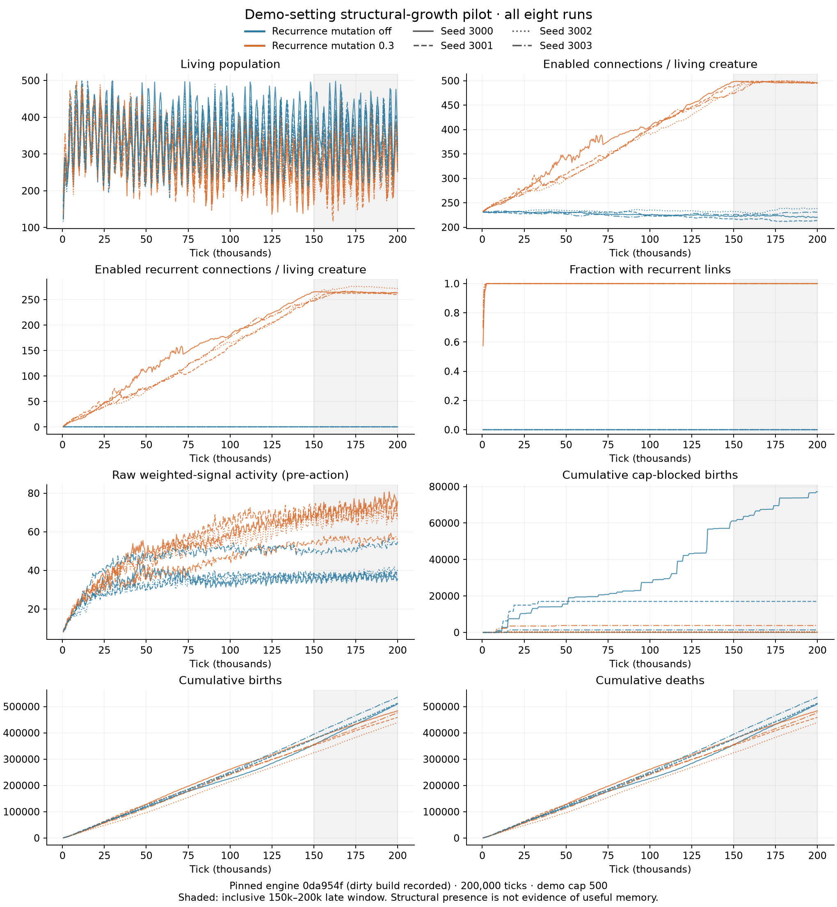

# Completed demo-setting recurrence-growth pilot — 2026-11-17

Result ID: **EXP-2026-11-17-MEMORY-GROWTH**. Status: exploratory structural/ecological diagnostic, independently audited. Not an established adaptive-memory result.

The owner's observation of rising connections is reproduced: all four recurrence-on worlds accumulated recurrent edges and approached a structural add-edge threshold. Late average population was lower with the 0.3 recurrence-add mutation setting. This does not show that remembered information helps behavior, or isolate mutation pressure from selection.

## Fixed design and complete dataset

[Plan fixed before launch](MEMORY_GROWTH_PILOT_PLAN_2026-11-17.md). Four fresh seeds 3000–3003 × recurrence-add probability 0/0.3; eight serial 200,000-tick runs. All eight completed, survived and have exactly 400 saved snapshots. Nothing excluded. The inclusive late window 150,000–200,000 contains 101 snapshots per world. Each world, rather than each organism/tick, is a replicate; n=4 paired seed labels is exploratory. Enabling recurrence changes subsequent organism random draws, so pairs do not retain identical evolutionary histories. Drought counts match at all saved paired ticks under the independent environmental stream.

All six demo overrides match the frozen plan: food 0.002, cap 500, season 3,600, drought spawn 0.0006/duration 1,500, day/night 600. Other settings use the pinned completed-baseline config. This differs from the experimental cap-2,000/food-0.008 baseline; do not conflate the two.

| Late mean across four worlds | Memory off | Recurrence mutation 0.3 |
|---|---:|---:|
| Living population | 336.426 | 277.406 |
| Enabled connections per living creature | 224.828 | 495.864 |
| Enabled recurrent connections per living creature | 0 | 264.926 |
| Enabled feed-forward connections per living creature | 224.828 | 230.938 |
| Fraction with recurrent links | 0 | 1.000 |
| Raw weighted-signal brain activity | 40.692 | 66.589 |

These are means of four run-level late means, not pooled-tick estimates. Between-run population SD: 21.333 off, 6.760 on; enabled-connection SD: 8.504 off, 1.714 on. The machine-readable report includes all per-run values, paired differences, SDs, final counters and exact artifact hashes. No confirmatory interval or significance claim is made.

| Seed | Late population off → on | Late enabled connections off → on | Late recurrent connections on |
|---|---:|---:|---:|
| 3000 | 364.327 → 279.614 | 222.581 → 496.714 | 264.359 |
| 3001 | 341.663 → 268.406 | 214.355 → 497.332 | 261.159 |
| 3002 | 317.584 → 284.554 | 234.451 → 495.978 | 271.829 |
| 3003 | 322.129 → 277.050 | 227.925 → 493.431 | 262.356 |



## What the observation supports

Recurrent edges account for about 97.75% of the between-condition difference in late mean total enabled connections. Both edge metrics use the same post-update living population denominator, so subtraction gives the feed-forward mean. In contrast, `mean_brain_activity` is a raw weighted-signal magnitude from pre-action thinking agents, with different timing; it is not an energy cost or a cognitive score. Separate realized structural/activity energy-ledger fields are retained in the JSON.

The on condition's late population is 59.020 lower on average (17.54% relative to off), with the same direction in all four late-window pairs. This is not uniformly true at every instant: seed 3002's final on population exceeds its final off population. Resource schedules, neural energetic charges and changed behavior/demography all participate; the experiment does not identify their individual causal contributions or a benefit-versus-cost optimum.

The 0.3 add-recurrent probability is much larger than 0.02 pruning. These are asymmetric operators, and selection/reproduction also matter. Growth is consistent with this strong mutation intervention. The encoded-gene add-edge threshold is 512, not an absolute enabled-edge or genome ceiling: split-node mutation can exceed it. Final on genomes have encoded-gene means about 513–515 and ranges 510–520, while enabled totals are about 495. This is bounded structural accumulation, not evidence of open-ended complexity or useful recall.

The demo population cap binds some runs: full-run cap-blocked births total 95,640 off versus 4,501 on, concentrated unevenly across seeds. This prevents treating the demo worlds as uncapped self-regulation. Retention/state-lesion experiments and competent visible-task acquisition remain separate gates. No donor champions were selected and no configuration changed after outcomes.

## Integrity, thermal operation and limits

Pinned engine source `0da954fa2911e5a0f075375b41196f8dafa6e4c8`; core `abad322241615ca2`; native aarch64 release, rustc 1.99.1. **Build records say source dirty=true**, inherited from the validated batch; archived engine source-status metadata and exact binary hash preserve this limitation. Protocol/launcher source `f63de31`. Binary SHA-256: `5b608d5f2002e74d4185e60c595e686d185362a13e89f4ba26aaa2dca9d274cb`.

Pi batch: `/home/pi/Digital-Terrarium/output/memory_growth/overnight_20261117T040010Z`, completed at 06:19:19 UTC, exit 0. Guard recorded 16 pause/resume pairs at thresholds 75/65°C and finished without owned pauses. Maximum logged transition temperature was 76.55°C. This log contains transitions, not a complete thermal or throttling time series; do not infer a maximum across unsampled instants or absence of historical throttling. Fresh check at 14:40 UTC: Pi idle, 52.7°C, flags `0xe0000` with no active low-bit throttling flags.

The earlier `overnight_20261117T035511Z` attempt failed before any simulated ticks because old CLI overrides were unsupported. It remains on the Pi. The full-config correction preserved all planned values and is documented in the plan.

Independent analysis reproduced all eight late summaries and final expressed-brain export counts. Strict script checks ordered job lists, pinned files, whole-tree configs, source/build metadata, finite unique complete CSV grids, zero recurrence off, final export/config/tick/population, and final expressed-edge means. Three dataset integration tests pass, including rejection of missing/duplicate samples, nonfinite values and incomplete status. Plots were rendered and visually checked.

## Reproduce and continue

[Machine-readable summaries and artifact hashes](memory_growth_pilot_2026-11-17.json). [Raw dataset archive](https://github.com/dchavan2192/Digital-Terrarium/releases/tag/memory-growth-pilot-2026-11-17) includes the binary, configs/manifests, every CSV/final genome, guard/worker and logs. Checkpoints and the failed zero-tick attempt remain on Pi; they are not in the public archive. Dataset-specific integration tests skip if the raw mirror is absent.

```bash
python3 analysis/summarize_memory_growth.py output/memory-growth/overnight_20261117T040010Z output/memory-growth/summary.json
python3 analysis/test_memory_growth_summary.py
MPLCONFIGDIR=output/memory-growth/mpl-cache analysis/.venv/bin/python analysis/plot_memory_growth.py output/memory-growth/summary.json output/memory-growth/trajectories.png
```

The committed JSON omits bulky trajectories, which can be reconstructed from the raw CSVs; script SHA-256 values identify the exact analysis. Extract the archive and use its `overnight_20261117T040010Z` directory as the first command's batch path.

**Stopping point:** Pi idle; no new experiment launched. Next is the [fixed visible acquisition pilot](VISIBLE_ACQUISITION_PILOT_PLAN_2026-11-17.md), after pinned-build, watchdog and guard readiness checks. Do not retune this completed diagnostic or interpret its accumulated recurrent links as learned memory.
