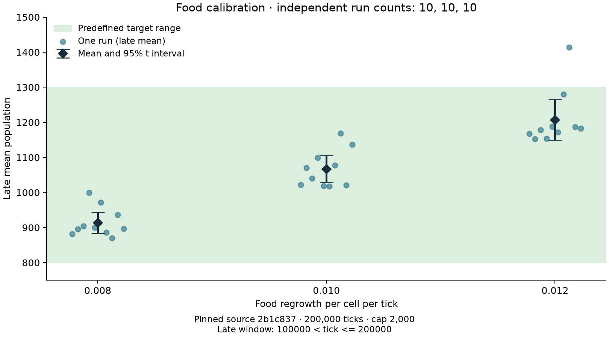

# Phase 9a held-out food-regrowth validation — 2026-11-16

Status: **completed calibration; baseline approved by owner on 2026-11-16; current-engine recheck pending**.
Result ID: CAL-2026-11-16-FOOD-VALIDATION.

All 30 runs survived to 200,000 ticks, with zero cap-blocked births. All three
candidates pass the four criteria fixed in [the validation plan](PHASE9A_VALIDATION_PLAN.md).
The predefined rule selects **0.008**, the smallest acceptable rate. The owner
approved adopting rate 0.008 and cap 2,000 for revalidation on the latest engine. This is a calibration of the pinned older engine, not evidence
that memory is adaptive or that the latest engine has the same equilibrium.

## Results

Each run is an independent replicate. Late population is the mean of 200 logged
snapshots at ticks 100,500–200,000; the uncertainty below is the sample standard
deviation across ten run means, not a confidence interval. The minimum covers
logged snapshots at ticks 20,000–200,000; dips between snapshots can be missed.

| Regrowth | Survived | Late population, mean ± SD | Range of run means | Lowest post-burn-in population | Cap-blocked births | Pass |
|---|---|---|---|---|---|---|
| 0.008 | 10/10 | 913.92 ± 41.79 | 869.62–998.95 | 620 | 0 | Yes |
| 0.010 | 10/10 | 1067.22 ± 53.66 | 1018.13–1168.51 | 719 | 0 | Yes |
| 0.012 | 10/10 | 1207.46 ± 80.83 | 1152.96–1413.39 | 810 | 0 | Yes |

All candidates meet: ten surviving seeds, no cap-blocked births, mean late
population between 800 and 1,300, and no logged post-burn-in minimum below 200.
The largest absolute reserve-energy balance residual was 2.37e-10.
No runs were excluded, resumed, or reported as technical failures.



Exploratory 95% Student-t confidence intervals across ten independent run means
are 884.02–943.81 (0.008), 1028.84–1105.61 (0.010), and 1149.64–1265.28 (0.012).
These intervals were added after the batch; they are not selection criteria.
They assume independent runs and an approximately normal sampling distribution
of their means. Ten surviving seeds per rate do not guarantee survival for all
seeds or longer runs. No significance test was needed for the predefined
engineering decision. Increasing food raised late population in every same-seed
comparison, but the older engine did not synchronize drought schedules across
rates, so these are not matched-environment causal estimates.

An independent agent audited all 90 stored CSV/configuration/manifest checksums,
all 30 completion/error fields, and the complete 400-snapshot schedule per run.
The strict summarizer reproduced the decision. This supports publication as a
calibration milestone; scientific evidence status remains unchanged.

## Exploratory ecology

These secondary endpoints were examined after the calibration and did not
change the acceptance rule. Values below average run means, with ten seeds per
rate. "Species" means operational genome-distance clusters.

| Regrowth | Late mean reserve energy | Late active connections | Late cluster count | Maximum logged population |
|---|---|---|---|---|
| 0.008 | 32.212 | 216.526 | 13.638 | 1,327 |
| 0.010 | 32.294 | 212.719 | 14.728 | 1,505 |
| 0.012 | 32.218 | 213.626 | 19.314 | 1,774 |

The selected baseline remained comfortably below the 2,000 ceiling in every
logged snapshot. Late population fluctuated: its within-run coefficient of
variation averaged 13.18% at 0.008. Reserve energy was similar across rates.

Do not call the population an established equilibrium. Mean population rose
between ticks 20,000–100,000 and 100,500–200,000: 870.16→913.92 (0.008),
1012.01→1067.22 (0.010), and 1116.96→1207.46 (0.012). Active connections fell
between those windows in all 30 runs; at 0.008, the mean fell 228.02→216.53.
This describes neural simplification in the older engine, which predates the
node-identity correction. It does not establish adaptive intelligence or its
cause. The stable-enough engineering criteria pass despite continuing drift;
longer stability and the latest engine remain unvalidated.

[Exploratory measurements per run](phase9a_validation_ecology_2026-11-16.json)
can be reproduced with:

```bash
python3 analysis/analyze_validation_ecology.py output/pi-validation/validation_20261116T021704Z_23586 docs/results/phase9a_validation_ecology_2026-11-16.json
```

## Public raw-data archive

[GitHub calibration dataset prerelease](https://github.com/dchavan2192/Digital-Terrarium/releases/tag/calibration-food-2026-11-16)
contains the mirrored CSVs, configurations, manifests and operational logs.
The archive SHA-256 is
`9ef870756080d379b321a68c55ba4a08f9001f1b4b1f1d0bea18c8c9c5f51cb0`.
All 90 recorded artifact hashes were checked against its contents before upload.
Checkpoints and the pinned executable remain on the Pi. This is a calibration
data release; it does not change scientific-evidence status.

## Provenance and reproduction

- Remote batch: `/home/pi/Digital-Terrarium/output/phase9a/validation_20261116T021704Z_23586`.
- Local logs/configuration mirror: `output/pi-validation/validation_20261116T021704Z_23586/` (ignored by Git). Checkpoints and the pinned executable remain on the Pi.
- [Machine-readable results and per-artifact SHA-256 checksums](phase9a_validation_2026-11-16.json).
- Source: `2b1c837ee093161afb99067659b3ac8f785ec806`; build `fab6214c28cf0b6d`, release, `aarch64-unknown-linux-gnu`, `rustc 1.99.1 (58cf8f9c3 2026-10-13)`.
- `source_dirty=true`: the archived source-status file lists only untracked `nohup.out` and `run_overnight.sh`. The tracked experimental source was clean.
- Seeds 100–109 for every rate; pinned `base.toml`, overrides `creature.hard_cap=2000` and candidate `food.regrowth_rate`; full effective configurations accompany each session and manifest.
- Two concurrent jobs, one Rayon thread each; logging every 500 ticks, checkpoints every 50,000 ticks. Manifest schema 2, stats schema 2, topology hash 2, checkpoint version 1.
- Analysis script at source `89e09925a685db7fb5bd7046ce09a5e869cc8b68`, SHA-256 `ee7b52cd1a47d3a0c5b2beaf2fcb2e745e02f90a786b7186beda5f5500d80a9f`.

```bash
python3 analysis/summarize_validation.py output/pi-validation/validation_20261116T021704Z_23586 docs/results/phase9a_validation_2026-11-16.json
MPLCONFIGDIR=output/matplotlib analysis/.venv/bin/python analysis/plot_validation.py docs/results/phase9a_validation_2026-11-16.json docs/results/phase9a_validation_2026-11-16.png
```

The strict summarizer accepted all jobs without `--allow-incomplete`. Remote
batch status was independently confirmed as `completed` at 17:06 UTC on
2026-11-16. The Pi had cooled to 57.1 °C with no active throttling at that check;
thermal logs retain the earlier throttling. Summed simulation time was 29.16
worker-hours. Throttling affects throughput, not the tick-defined trajectories.

## Limits and next action

The batch predates independent drought randomness, population-wide node
identity, and recurrent memory. Its environment stream was shared with
evolution, as recorded in each manifest. These observations calibrate average
behaviour of that older build; they do not validate feature comparisons or the
current engine. The pilot used other seeds, and this held-out batch followed
the written selection rule. It does not establish multi-million-tick stability.

The owner approved the proposed food rate and cap on 2026-11-16. Both
`food.regrowth_rate=0.008` and `creature.hard_cap=2000` are now the defaults.
The [current-engine recheck plan](CURRENT_BASELINE_RECHECK_2026-11-16.md) reuses
the ten seeds to test this baseline after the intervening engine changes. Keep recurrent
memory off by default until the delayed-response behavioural test and controlled
comparison are ready. Improve Pi cooling before another long campaign.
