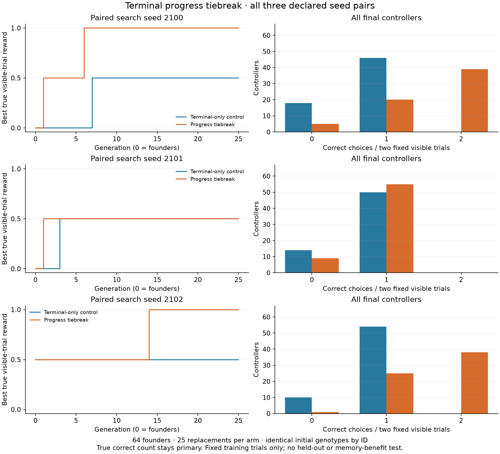

# Completed terminal-progress tiebreak comparison — 2026-11-17

Result ID: **EXP-2026-11-17-PROGRESS-TIEBREAK**. Paired training-only engineering pilot, independently audited. No confirmatory efficacy, held-out validation, memory-use, within-life learning or ecological result is claimed.

**The progress-tiebreak method acquired both fixed visible responses in two of three searches; terminal-only controls did so in zero of three.** The partial treatment search is retained. This demonstrates acquisition feasibility under this teacher-informed search objective on these training trials. Three seed pairs do not establish a reliable success rate, robust navigation or adaptive memory.

## Prospective design and full cohort

[Plan fixed before outcomes](TERMINAL_PROGRESS_COMPARISON_PLAN_2026-11-17.md), [method/research limits](../research/TERMINAL_PROGRESS_ACQUISITION_2026-11-17.md). All six declared searches completed: fresh seeds 2100–2102, 64 founders, 25 replacements after generation 0,8 elites,tournament3, weight probability 0.1/step 0.2. Recurrence, structural/trait mutation and lifetime updates are off; native neutral hue drift remains unused.

The only selection intervention is among equal correct counts: control uses lower persistent ID; treatment first uses mean terminal progress, then ID. True first-contact correctness stays primary. Terminal progress is clipped, normalized distance to the assigned goal disc, measured only after first contact or horizon. Confirmed correct contact is exactly1. It does not enter sensors, neural state or an online reward. Arena, cue mapping, geometry, terminal rewards and horizon 20 remain fixed.

Canonical founder-genome inventories match by ID for every seed pair, regardless of rank order. Subsequent parent histories differ, as expected when selection changes. The independent comparison unit is the **paired search seed, n=3**, not six independent initializations or thousands of controllers.

| Seed | Best founder reward (both arms) | Control final reward | Progress final reward | First full acquisition in treatment | Final treatment counts: 0 / 1 / 2 correct |
|---|---:|---:|---:|---:|---:|
| 2100 | 0 | 0.5 | 1.0 | Generation6 | 5 / 20 / 39 |
| 2101 | 0 | 0.5 | 0.5 | None | 9 / 55 / 0 |
| 2102 | 0.5 | 0.5 | 1.0 | Generation14 | 1 / 25 / 38 |

Control final counts were 18/46/0, 14/50/0 and 10/54/0. All 78 generation records per arm are retained, each with 64 score entries. Work totals are 4,992 candidate evaluations per arm, 9,984 overall, including repeated elites. They are not independent replicates or a count of distinct genomes.

Paired differences in final champion mean true reward are +0.5,0,+0.5 (descriptive mean +0.3333). No confirmatory confidence interval or significance test is presented. Population mean-reward differences are separately retained in the JSON; distance gains are not substituted for the primary endpoint.



## What was acquired—and what remains untested

Treatment champions #381 and #818 arose in generations 6 and14; neither was a fully successful random founder. Both select right for cue−1 and left for cue+1. Seed2100 contacts both goals at movement tick20; seed 2102 contacts right at 20 and left at 15. Treatment seed 2101 remains partial: right/correct at 11, positive-cue timeout at 20. Controls each make only one correct choice. Full per-cue outcomes, final traces and progress values remain available.

All networks are feed-forward and the cue is visible during movement. Both-cue success therefore establishes a fixed conditional sensor-to-action response discovered across generations, not storage of a missing cue or associative learning during a life. Intact and state-cleared final trials match, as expected. Several successful contacts lie exactly on the frozen20-tick boundary: valid successes, but a reason not to infer robustness, extra delay tolerance or transfer to new geometry.

This method uses the teacher-assigned target after each trial. It is a different explicit evolutionary search objective, not policy-invariant MDP reward shaping, spontaneous ecological selection or a change to organism fitness in the public demo. The default `terminal_only` method, original configs and archived seeds 2000–2002 result remain unchanged. No extra generations, replacement seeds, mapping changes or successful-cohort filtering were used.

## Provenance, integrity and operations

Execution source `72f7c5b32119e57dddb062e957543ada6e2db53d`, clean isolated Pi release build; core `297edc68fb18e05e`, rustc 1.99.1, aarch64. Both arms used identical executable bytes, SHA-256 `01212c3c9cb6151a46bb43672b07dc0b5e73f9666cbc3e573a18de1575e22b60`. All frozen Rust/config hashes matched the prospective plan. Operational/analysis source `a2971d5` was saved before launch.

Parent: `/home/pi/Digital-Terrarium/output/acquisition/progress_comparison_20261117T205542Z`. Control ran21:06:42–47 UTC; treatment21:06:47–52 UTC, both exit0. Parent completed exit0. Each supervisor elapsed approximately 5.132 seconds including guard finalization; this tiny run is not an algorithmic throughput benchmark. No other simulation ran concurrently, and prior outputs/binaries remain untouched.

Each arm used one serial runner, the declared 1,800-second active watchdog, and 75/65 °C thermal guard. Both guards finished normally without pauses. Initial telemetry was55.1 °C/54.55 °C; final guard readings 55.65 °C/56.75 °C. Initial hardware flags `0xe0000` had no active low-bit flags. Runs finished between five-second guard samples, whose transition logs show no active matching runner: these sparse observations are not continuous thermal coverage or a measured maximum. Fresh post-run reading was 55.4 °C. No safety deadline or technical rerun occurred.

Independent raw-data audit verified 24 prepared inventory entries, matched binary/builds, all 156 generation logs, elite/parent/ID allocation, exact 231-edge/eight-hidden-node feed-forward topology, fixed mutation parameters and marks, founder equality across arms, and final cue/pose/reward records. The auditor independently recomputes terminal progress from the recorded terminal positions within 1e−12 and rejects nonfinite/duplicate JSON. Primary scores are checked separately from secondary diagnostics.

Validation: 161 workspace Rust tests, all-target Clippy/format, seven supervisor process tests and seven predeclared pure auditor tests pass. Three post-collection dataset corruption/integration tests additionally check full-cohort completion, missing records, nonfinite progress and altered founder pairing. These extra tests do not change scoring or analysis endpoints; the raw archive preserves the original pre-launch test script. Figure was rendered and visually inspected.

## Reproduce and next gate

[Machine-readable comparison and artifact hashes](terminal_progress_comparison_2026-11-17.json). [All-arm raw archive/checksums](https://github.com/dchavan2192/Digital-Terrarium/releases/tag/terminal-progress-comparison-2026-11-17) contains both pinned executables/inputs, all founders and final populations, full generation IDs/parents/scores, per-cue traces, source/build/operational records, supervisor/guard and frozen analysis scripts. Intermediate full genotypes are not claimed to be archived.

```bash
python3 analysis/summarize_progress_comparison.py output/progress-comparison/progress_comparison_20261117T205542Z output/progress-comparison/summary.json --source 72f7c5b32119e57dddb062e957543ada6e2db53d
python3 -m unittest discover -s analysis -p 'test_progress_comparison.py'
MPLCONFIGDIR=output/progress-comparison/mpl-cache analysis/.venv/bin/python analysis/plot_progress_comparison.py output/progress-comparison/summary.json output/progress-comparison/curves.png
```

Extract the archive under `output/progress-comparison/` for these paths. Code/input, archive and individual-payload SHA-256 values are retained. Do not write summaries inside the raw parent, since that would pollute the stable inventory.

**Next gate:** freeze fresh repeatability/validation conditions and assess complete visible-task competence before selecting for hidden-delay retention. Keep these pilot seeds out of any confirmatory cohort, retain the partial search, and specify held-out tasks before observing their scores. Rotations alone mostly test absolute-heading robustness under this egocentric geometry; they do not establish general navigation transfer. No further study was launched after this comparison. The research tiebreak remains outside the ecological browser demo.
