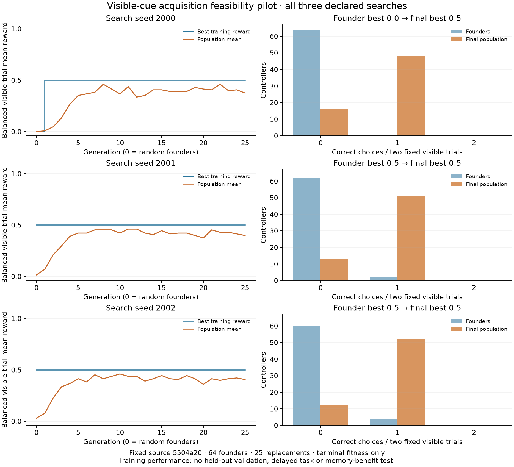

# Completed visible-cue acquisition feasibility pilot — 2026-11-17

Result ID: **EXP-2026-11-17-VISIBLE-ACQUISITION**. Engineering feasibility result, independently audited; not an adaptive-memory or held-out validation result.

**No search acquired both correct visible-cue responses within the fixed budget.** Seed 2000 improved from zero to one correct choice; seeds 2001/2002 retained the best founder score of one correct choice. All three completed without technical failures. This is a limitation of this finite search procedure, not evidence that the architecture cannot solve the task or that agents lack memory.

## Frozen design and complete outcomes

[Scientific plan](VISIBLE_ACQUISITION_PILOT_PLAN_2026-11-17.md), [pre-launch operational record](VISIBLE_ACQUISITION_OPERATIONS_2026-11-17.md). Three independently seeded founder-population searches (2000–2002), 64 random feed-forward founders, 25 replacement generations plus generation zero; eight elites and tournament size three. Native weight mutation 0.1/0.2; topology, recurrence and scalar-trait mutations off. Native neutral hue drift remains, unused by the arena.

Fitness is the count of correct first goal contacts in two balanced visible-cue trials, with timeout/wrong contact zero and persistent lower ID breaking ties. The cue is available during movement, held pose and geometry are fixed, and there is no hidden-task score, shaping, within-life update or held-out feedback. All settings, budgets and seeds were retained. No early stopping, extensions, extra seeds, mapping flips or score-driven exclusions occurred.

| Search seed | Founder scores: 0 / 1 / 2 correct | Final scores: 0 / 1 / 2 correct | Best founder → final mean reward | Final champion |
|---|---:|---:|---:|---|
| 2000 | 64 / 0 / 0 | 16 / 48 / 0 | 0 → 0.5 | #117, born generation 1 |
| 2001 | 62 / 2 / 0 | 13 / 51 / 0 | 0.5 → 0.5 | #17, founder |
| 2002 | 60 / 4 / 0 | 12 / 52 / 0 | 0.5 → 0.5 | #3, founder |

Every one of the 78 generation logs contains 64 score records. No evaluated candidate scored two correct in any generation. There were 1,664 candidate evaluations per search, **4,992 total**, including repeated elite evaluations. These are not 4,992 independent replicates or unique genomes; 1,464 candidate IDs are introduced per search. Intermediate full genomes are not claimed to be archived: all founders, all final populations, and every generation's IDs/parents/scores are retained.

Final population mean rewards were 0.375, 0.3984375 and 0.40625. These are descriptive means within the selected populations; n=3 search runs is the repeatability unit. Population enrichment for partial fitness is not acquisition of the complete balanced rule.



## Champion replay and interpretation

All final champions choose the correct left goal for cue +1. For cue -1, seed 2000 times out at 20 movement ticks; seeds 2001/2002 choose the wrong left goal. Correct +1 contacts occur at 13, 15 and 17 movement ticks respectively; wrong -1 contacts at 16 and 15 ticks. The final feed-forward intact and all-ticks-cleared replays are identical, as expected. Manufactured visible controls each reward 1, establishing instrument feasibility rather than search success.

The complete rule requires both responses. Binary terminal fitness offers only three score levels, and the observed champions plateau at 0.5. This is compatible with a coarse search objective and the declared finite mutation/selection budget, but this pilot does not identify which optimizer choice caused the limitation. In two searches the final champion is literally a retained founder, so it must not be presented as a newly acquired successful policy.

This result does not justify launching delayed-memory selection or interpreting hidden-task failure as a memory deficit. The next development unit is to diagnose/revise the acquisition method under a separately declared engineering protocol, preserving this null/partial result. Any changed fitness or selection method needs a new explicit record and fresh planned evaluation; do not silently relabel it as continuation of this pilot. Confirmation and generalization require a frozen validation design beyond these training trials. No further experiment was started in this result record.

## Provenance and operations

- Exact execution source: `5504a20746bfe0dfcff54b95546324c02db1058d`, clean isolated worktree; manifest `source_dirty=false`. Core build `297edc68fb18e05e`, aarch64 release, rustc 1.99.1.
- Frozen protocol/arena hashes match the pre-execution plan. Operational supervisor/source record `400eea3` was committed before launch. The original root checkout and every prior pinned experiment binary remain intact.
- Pi batch: `/home/pi/Digital-Terrarium/output/acquisition/pilot_20261117T163705Z`. Start 16:39:32 UTC, final supervisor completion 16:39:38 UTC, exit 0. Exact supervisor elapsed time 5.134 seconds includes guard startup/finalization. Reported search elapsed times were 0.731, 0.732 and 0.731 seconds; these are single measurements, not throughput benchmarks.
- Active-command watchdog fixed at 1,800 seconds including startup/cooling, with separately bounded guard cleanup. It did not trigger. One serial runner, `RAYON_NUM_THREADS=1`.
- Guard required a fresh matching monitoring status before launch, thresholds 75/65°C and poll five seconds; final guard state `finished`, exit 0, no pauses. The very short runner finished between guard polling samples: the guard did not log an active matching runner. Telemetry records 53.45°C at supervisor start, guard transitions 54.55°C initially/54.0°C at completion; this is not continuous thermal coverage or a measured maximum. Initial throttling flags `0xe0000` contained no active low-bit flags. The small bounded single-worker run and cool startup should not be generalized into thermal assurance for a longer campaign.

## Audit, retention and reproduction

Strict audit passes for all three seeds: exact 231-edge/8-hidden-node topology, zero recurrence/methylation, invariant mutation parameters, matching pinned inputs/build provenance, all generation counts, rank/ID ties, unchanged eight elites and 56 new valid-parent offspring each replacement, founder/final consistency, cue mapping, visible response channel, held pose and continuous replay poses. Independent review reproduced all outcomes and checked the eleven prepared build/operational hashes. Three dataset integration tests pass, including rejection of missing generations, empty controls, altered topology and mismatched visible replay. Seven supervisor process tests and ten thermal-policy tests pass; CI includes the safety tests. Figure was rendered and visually checked.

[Summary, generation aggregates and full artifact inventory](visible_acquisition_pilot_2026-11-17.json). [Raw reproducibility archive](https://github.com/dchavan2192/Digital-Terrarium/releases/tag/visible-acquisition-pilot-2026-11-17) includes the pinned binary, inputs, supervisor/guard/analysis scripts, source/build records, thermal/log records, every founder/final genotype, complete generation score records and champion traces. No ecological-export tick is invented for task-selected policies.

```bash
python3 analysis/summarize_acquisition.py output/visible-acquisition/pilot_20261117T163705Z output/visible-acquisition/summary.json
python3 analysis/test_acquisition_summary.py
MPLCONFIGDIR=output/visible-acquisition/mpl-cache analysis/.venv/bin/python analysis/plot_acquisition.py output/visible-acquisition/summary.json output/visible-acquisition/curves.png
```

Extract the raw archive beneath `output/visible-acquisition/` to use these paths. The committed JSON retains generation aggregates but omits bulky per-controller score lists, which remain in the raw archive. Analysis-script and archive SHA-256 values identify the exact artifacts. The independent unit and absence of held-out validation remain explicit even if this dataset is reused.
