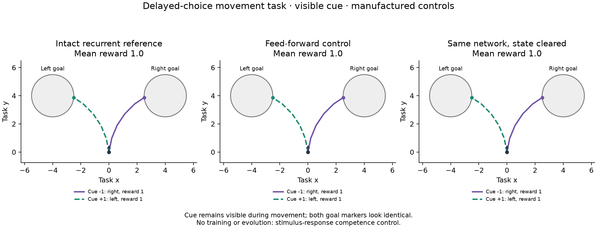

# Visible-cue competence diagnostic — 2026-11-17 UTC

Status: **instrument controls passed; donor task competence not established**.
ID: CHK-2026-11-17-VISIBLE-CUE-COMPETENCE.

We added the planned `--cue-visible` condition to the same movement arena.
Only the cue input during movement changes: visible trials retain the original
signed cue; default delayed trials receive zero after release. Geometry,
weights/snapshot marks, held phases, horizon, reward mapping and donor order
are unchanged. The [plan](VISIBLE_CUE_CONTROL_PLAN_2026-11-17.md) preceded the
actual donor comparison. No parameter or mapping was tuned after outcomes.

## Manufactured competence controls

| Controller | Delayed mean reward | Visible mean reward |
|---|---|---|
| Recurrent reference | 1.0 | 1.0 |
| Feed-forward reference | 0.5 | 1.0 |
| Same recurrent network, state cleared each tick | 0.5 | 1.0 |

All reference trials chose a goal after five movement ticks, without timeouts.
This demonstrates that the task is solvable without retention when the cue is
present. It does not demonstrate training, learned association or adaptive
memory in evolved genotypes.



[Complete reference traces](visible_cue_controls_2026-11-17.json).

## Same 898 natural donor controllers

Every donor was evaluated for both balanced cues in both visibility conditions,
intact and with neural state cleared. All are feed-forward; intact/reset full
trial records match within each condition. Held-phase records are identical
between conditions, and first movement inputs differ only at cue channel 12.
Pose-dependent sensor values can legitimately diverge after actions differ.

| Outcome across 1,796 deterministic trials | Delayed | Visible |
|---|---|---|
| Correct goal contacts | 7 | 0 |
| Wrong goal contacts | 7 | 31 |
| Timeouts | 1,782 | 1,765 |
| Controllers with any goal contact | 7 | 31 |
| Controllers correct for both cues | 0 | 0 |
| Mean reward | 0.0038976 | 0.0000000 |

All visible contacts reached the left goal for the negative cue, which is
wrong under the fixed mapping; every positive-cue visible trial timed out.
The paired mean reward difference (visible minus delayed) was
-0.0038976. This is a descriptive one-donor
diagnostic, not a general harm-of-visibility result or a memory-effect estimate.

**These donors have not demonstrated competence in this unfamiliar cue–goal
task even with the cue available. Their delayed failures cannot be attributed
to memory.** They evolved in a different ecology; novel sensor conventions,
cue mapping, horizon and motor demands can all affect transfer. We do not
flip the answer mapping, select winners or retune the geometry to obtain a
positive result. The genomes and repeated deterministic trials are correlated,
not independent evolutionary replicates. No significance test is applied.

## Provenance and verification

- Clean evaluator `bda6f3591bb928c1515d40fd4f02a8a55dcdf2b8`, release
  `aarch64-apple-darwin`, `rustc 1.99.1 (58cf8f9c3 2026-10-13)`;
  core `83292ca5eb55ebf5`. Both conditions use this same build.
- Same donor as the prior arena: source 0da954f, seed 100, tick 200,001, 898 records.
  Export SHA-256 `0bcab908515cbbb6da5fbc216a52c432f0ddb3dc1f2098e012bc872ff4cf1077`;
  arena SHA-256 `7a47f36167419d92c0ab7414d11b4c399526dc90196fd64d7d938e1c6372f213`.
- [Paired per-genotype summary and output hashes](visible_cue_summary_2026-11-17.json).
  Full local outputs are `output/visible-cue-control_2026-11-17/hidden.json`
  and `visible.json`. Hidden has 48,744,252 bytes; visible
  has 48,733,572 bytes. Wall time was 0.719s
  and 0.737s respectively, on the local machine, not a Pi
  throughput benchmark.
- Independent parse-only audit recomputed donor/arena/output hashes, checked
  all 898 paired identities, hold phases, cue input differences, correct/wrong
  counts and intact/reset correspondence. Every delayed trial also matches
  the archived 0bc1be2 implementation exactly.
- 153 Rust tests, 10 JS tests and 10 thermal tests pass; all-target Clippy/format
  pass. Full Cargo suite was serialized. No simulation ecology changed and
  no new sustained Pi work was launched for this diagnostic.

```bash
cargo build -p sim-runner --release
target/release/sim-runner delayed-choice --arena configs/delayed_choice.toml --cue-visible
target/release/sim-runner evaluate-delayed-choice --input donor/genomes.json --arena configs/delayed_choice.toml
target/release/sim-runner evaluate-delayed-choice --input donor/genomes.json --arena configs/delayed_choice.toml --cue-visible
```

The [existing instrument data release](https://github.com/dchavan2192/Digital-Terrarium/releases/tag/delayed-choice-instrument-2026-11-16)
now also contains `visible-cue-competence-2026-11-17.tar.gz`, with both full
outputs, controls, paired summary, arena and plan. Its archive SHA-256 is
`4bf8b1c9245098719b6a8e37ee6e102b4e29910f84872ec98a8a92b9d5367331`.
The donor genotypes are retained in the original archive from that same release.

## Consequence for development

The ecological baseline gate has passed, but the competence diagnostic blocks
interpreting this transfer task as a measure of evolved memory performance.
Define and validate a way to establish task competence, or an ecologically
relevant behavioural endpoint, before a memory-selection comparison. Declare
any training/selection protocol and fresh validation donors before collecting
its outcomes; retain these negative diagnostics unchanged. Memory remains off
in the default ecology, and no positive memory/cognition claim is registered.
