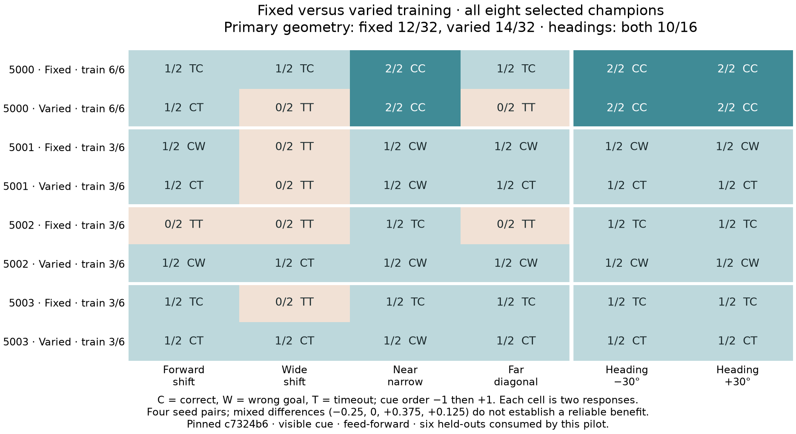

# Visible-cue training-diversity pilot — 2026-11-22

Result ID: **EXP-2026-11-22-VISIBLE-DIVERSITY**. Completed one-off engineering pilot, four paired search seeds. Schedules remain disabled.

Varied training scored **14/32** correct held-out geometry responses versus **12/32** for fixed-reference training. The prespecified mean of four seedwise differences was **+0.0625** in correct fraction, with differences ranging from **−0.25 to +0.375**. Two pairs favored varied training, one favored fixed training and one tied. Heading-only scores were identical in every pair. These mixed results do not establish a reliable generalization benefit from varied training.

All eight searches and their training-selected champions are retained. Only seed 5000 reached all six training responses correct, in both arms. The other six champions reached three of six. Their held-out results remain in the primary denominator; no successful-seed filtering, additional training, test-based champion choice or outcome-dependent rerun occurred.

[Full raw-data prerelease and checksums](https://github.com/dchavan2192/Digital-Terrarium/releases/tag/visible-diversity-pilot-2026-11-22). The archive preserves every training population, selected champion, trace, pinned Pi executable and thermal record.



The [demo Task lab](https://dchavan2192.github.io/Digital-Terrarium/demo/) replays the exact saved poses of all eight champions and both cues, alongside the separate earlier study. Choose one-layout or three-layout training; its six cases, evaluator and evidence links update together.

## Frozen comparison and provenance

[Prospective plan](VISIBLE_DIVERSITY_PLAN_2026-11-18.md), [committed prelaunch record](visible_diversity_launch_2026-11-22.json), and [machine-readable audit, complete matrix and artifact hashes](visible_diversity_pilot_2026-11-22.json).

Four fresh seeds 5000–5003 each had fixed and varied arms with matched founder genomes and IDs. Both arms used population 64, founder generation plus 25 replacement generations, eight elites, tournament size three and eight hidden nodes. Each of the 1,664 candidate evaluations per search received six training trials: both cues on three ordered layout slots. Fixed training repeated the reference layout three times; varied training used reference, near and narrow. Repeated reference trials are budget controls, not independent replicates. Founders and evolutionary histories can diverge after selection, even with matched initial genomes.

The eight searches completed exactly **13,312 candidate evaluations and 79,872 scheduled training trials**. Controllers were feed-forward, with fixed topology and weight mutation only; independent upstream diet mutation was explicitly disabled in this isolated search. Native neutral hue drift was retained. Training ranked correct count first, then terminal progress, then persistent ID. Assigned goals/progress were not controller inputs or online rewards.

Every training attempt finished before the campaign-wide `selection_lock.json` was written. The lock identifies all eight selected champions and the exact bytes of seven training artifacts per search. Only the second phase evaluated the six held-out conditions. The audit reproduced all **56** locked training-file identities and four matched founder pairs, checked every 26×64 score matrix, rank, elite and parent/ID transition, and verified final champions against training rank. The source contains separate training and held-out loops; fingerprints establish artifact identity rather than independently proving execution chronology.

Clean native source: `c7324b6ba6d2c6a57523c83cad2575d7a8ee75be`; core build `76b23bc91f012cd7`; aarch64 release, rustc 1.99.1 (`58cf8f9c3`, 2026-10-13). Binary SHA-256: `682bb415d26dd5009220e6b6a775d9a153e30b97d8c97055cf3c023c5e6df02b`. Full protocol/arena, supervisor/guard and prospective launch hashes are retained. This revision includes upstream diet/visual-shadow changes; earlier pilots are context, not a clean cross-study treatment comparison.

## All searches and training outcomes

Training scores are out of six, measured on different arm-specific distributions. They are not a common external test. “First 6/6” is the first saved generation containing an all-correct candidate; founders are generation zero. Terminal progress is diagnostic and cannot outrank an additional correct response.

| Seed | Arm | Founder best → final correct /6 | Final training progress | First 6/6 generation | Champion ID | Geometry /8 | Heading /4 |
|---|---|---:|---:|---:|---:|---:|---:|
| 5000 | Fixed | 0 → 6 | 1.000000 | 16 | 952 | 5 | 4 |
| 5000 | Varied | 1 → 6 | 1.000000 | 10 | 571 | 3 | 4 |
| 5001 | Fixed | 3 → 3 | 0.500000 | Never | 42 | 3 | 2 |
| 5001 | Varied | 2 → 3 | 0.563050 | Never | 1431 | 3 | 2 |
| 5002 | Fixed | 0 → 3 | 0.895588 | Never | 1446 | 1 | 2 |
| 5002 | Varied | 1 → 3 | 0.563050 | Never | 1435 | 4 | 2 |
| 5003 | Fixed | 3 → 3 | 0.500000 | Never | 26 | 3 | 2 |
| 5003 | Varied | 2 → 3 | 0.563050 | Never | 752 | 4 | 2 |

On the common reference layout, seed 5000 solved both cues in each arm; every other champion solved one cue in each arm. Varied seed 5000 also solved both cues on near and narrow. The other varied champions solved one cue per training layout. The earlier 6/6 generation in one varied search does not establish faster acquisition across search populations.

## All held-out cases

Each cell is correct responses out of the two signed cues. Four relative geometries form the primary endpoint; the two rigid heading rotations form the secondary endpoint. All cases retained the same sensors, goal radius, cue mapping and movement horizon. Complete per-cue choices, timeout ticks and progress are in the machine-readable report and raw traces.

| Seed | Arm | Forward shift | Wide shift | Near narrow | Far diagonal | Heading −30° | Heading +30° |
|---|---|---:|---:|---:|---:|---:|---:|
| 5000 | Fixed | 1 | 1 | 2 | 1 | 2 | 2 |
| 5000 | Varied | 1 | 0 | 2 | 0 | 2 | 2 |
| 5001 | Fixed | 1 | 0 | 1 | 1 | 1 | 1 |
| 5001 | Varied | 1 | 0 | 1 | 1 | 1 | 1 |
| 5002 | Fixed | 0 | 0 | 1 | 0 | 1 | 1 |
| 5002 | Varied | 1 | 1 | 1 | 1 | 1 | 1 |
| 5003 | Fixed | 1 | 0 | 1 | 1 | 1 | 1 |
| 5003 | Varied | 1 | 1 | 1 | 1 | 1 | 1 |

Only seed 5000, in both arms, solved both cues on any changed relative geometry: the near-narrow case. Neither arm produced a champion solving both cues on every held-out geometry. Gains for seeds 5002 and 5003 therefore do not establish balanced two-cue competence. Across primary geometry trials, fixed training produced 12 correct contacts, three wrong contacts and 17 timeouts; varied training produced 14 correct, five wrong and 13 timeouts. A timeout is a zero-reward task failure, distinct from an incorrect goal contact.

| Seed | Fixed geometry fraction | Varied geometry fraction | Varied − fixed | Heading difference |
|---|---:|---:|---:|---:|
| 5000 | 5/8 | 3/8 | −0.250 | 0 |
| 5001 | 3/8 | 3/8 | 0.000 | 0 |
| 5002 | 1/8 | 4/8 | +0.375 | 0 |
| 5003 | 3/8 | 4/8 | +0.125 | 0 |
| Arithmetic mean | 0.375 | 0.4375 | +0.0625 | 0 |

All four planned pairs are available; none are missing. The primary paired range is [−0.25, +0.375]. Heading scores are 10/16 in each arm, or mean fraction 0.625; its paired range is [0, 0]. Heading rotations preserve egocentric geometry and probe an absolute-heading nuisance rather than a new relative navigation task. Cues, cases, candidate evaluations and saved generations are repeated measurements within searches, not additional independent replicates. No significance test or confirmatory claim is made from four pairs.

The manufactured visible-cue controls passed. All evolved held-out and champion training traces had exact intact-versus-state-cleared trial equality, as expected for these feed-forward controllers. Independent checks reconstructed motion/first goal contact from archived actions and recomputed terminal progress from final poses. These checks validate the instrument and artifact accounting; they do not establish memory use.

## Runtime, thermal operation and limits

The guarded batch ran from **23:48:14.536 to 23:48:29.685 UTC on 2026-11-22**, with supervisor elapsed time **15.149 seconds**, including startup and guard finalization. Summed per-search active training times were 10.348 seconds and held-out evaluation times 0.0767 seconds. Those per-search timers exclude intervening work on other searches and selection-lock hashing; they are not end-to-end benchmarks. One thread was used, with the fixed 1,800-second inclusive active-command watchdog. Runner, supervisor and guard exited zero; the guard finished with no matching runner or owned pause. No schedules were enabled.

Three supervisor telemetry snapshots recorded **55.1, 58.4 and 58.95°C**; final guard temperature was 58.95°C. No thermal pause occurred. All three hardware readings were `throttled=0xe0000`: historical flags were retained and no current low-bit throttling flags were set at those sampled instants. Sparse observations cannot establish a continuous temperature maximum or uninterrupted absence of throttling. Preparation recorded more than 20 GiB free disk and 3 GiB available RAM; these were preflight checks, not continuous resource monitoring.

This pilot changes diversity and weighting among three chosen training geometries under a finite search budget. It neither identifies a universal advantage of varied training nor establishes an optimal curriculum or a learning mechanism. Genetic optimization across generations is distinct from within-lifetime learning. The six formerly untouched test conditions are now consumed; another generalization claim requires new prospective tests and, where appropriate, fresh seeds. No ecological adaptation, useful memory, selection-versus-drift, open-ended evolution or UAL conclusion follows.

## Reproduce the artifact audit

Native Pi batch: `/home/pi/Digital-Terrarium/output/visible_diversity/pilot_20261122T233000Z`; local mirror: `output/visible-diversity/pilot_20261122T233000Z`. The read-only auditor checks the complete batch against the committed prospective launch record and writes a fresh result file. It does not run a controller or resume training.

```bash
python3 analysis/summarize_visible_diversity.py output/visible-diversity/pilot_20261122T233000Z --output output/visible-diversity/reproduced_summary.json
python3 analysis/test_visible_diversity_summary.py
```

The independent audit matched the parent summary exactly, and a separate raw-JSON calculation reproduced every outcome cell and all four pair contrasts. Raw training populations, generation logs, lineages, selection lock and complete cue traces are preserved regardless of task success.
