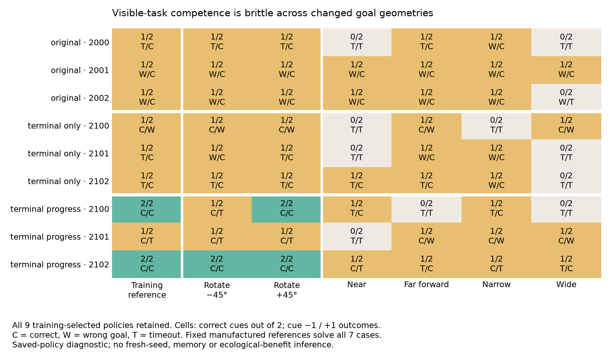

# Saved visible-task policies fail the changed-geometry competence gate

The frozen seven-case diagnostic reproduced all nine archived champions' original trials exactly. The progress method's two full training successes do **not** transfer as complete two-cue policies to any of the four changed relative goal geometries. Fixed manufactured feed-forward and recurrent references solve every case. This is a useful limitation of these saved policies, not a fresh-seed optimizer comparison or a memory result.

## All-cohort results

Each cell below is the number of training-selected policies that solve **both** cues, out of three. The original pilot is a separate descriptive cohort. Repeated cases/cues/reset checks are not independent search replicates.

| Frozen case | Original pilot | Paired terminal-only | Paired terminal-progress | Progress cue outcomes: correct / wrong / timeout |
|---|---:|---:|---:|---:|
| Training reference | 0/3 | 0/3 | 2/3 | 5 / 0 / 1 |
| Rigid rotation −45° | 0/3 | 0/3 | 1/3 | 4 / 0 / 2 |
| Rigid rotation +45° | 0/3 | 0/3 | 2/3 | 5 / 0 / 1 |
| Near `(3,3)` | 0/3 | 0/3 | 0/3 | 2 / 0 / 4 |
| Far-forward `(5.5,4)` | 0/3 | 0/3 | 0/3 | 2 / 1 / 3 |
| Narrow `(4,2.5)` | 0/3 | 0/3 | 0/3 | 3 / 1 / 2 |
| Wide `(4,5)` | 0/3 | 0/3 | 0/3 | 2 / 1 / 3 |

Relative offsets are `(forward,lateral)` in the release frame. All other arena rules remain fixed, including horizon20 and visible cue. Rigid rotations move heading and both goals together and mainly probe the absolute-heading input. Near preserves the original center bearing while changing distance and apparent angular size; the other relative cases change center distance and bearing together. None isolates every sensory variable.



Progress seed2100 loses cue+1 at −45° (timeout), but keeps both responses at +45°. Seed2102 keeps both under both rigid rotations. In changed relative geometries seed2100 has 1,0,1,0 correct cues; seed2102 has 1,1,1,1. Partial seed2101 has 0,1,1,1, with its last three cases contacting right for both cues. Every unsuccessful policy/case remains in the data. No candidate was replaced based on validation scores.

The previously reported 2/3 training acquisition result still holds for its original task. It does not establish broad visible-task competence. Even moving goals nearer fails to preserve complete success; this result cannot be reduced to insufficient travel time or assigned a single causal sensor failure. No horizon extension, reward revision or post-outcome tuning was performed. Full competence under varied visible conditions remains the gate before delayed-memory selection.

## Controls, provenance and audit

- Prospective [plan](VISIBLE_VALIDATION_PLAN_2026-11-17.md)/suite/evaluator committed at `b40ae9c`; [operational record](VISIBLE_VALIDATION_OPERATIONS_2026-11-17.md), launcher and initial auditor at `09226d3`, before outcomes. No archived policy was evaluated on these cases during design. Source-summary hashes for all nine policies were manually checked against the predeclared trace-diagnosis list before launch; all matched in cohort/seed order.
- Clean evaluator revision `b40ae9c15ef5f90f17e7e2bbbc286c1c19c0b88c`; executable SHA-256 `05e6fe23121818fb897332a53f314da11e2ea98fed6f61cfe52d607009833e63`. Clean single-worker native release build; original Pi checkout and old pinned binaries preserved. Full evaluator/compiler/core identity is in the [machine-readable audit](visible_validation_2026-11-17.json).
- All three source cohorts and all63 policy/case combinations completed: 126 intact cue trials plus126 corresponding state-cleared trials. Every feed-forward intact/reset trajectory agrees exactly. These resets are instrument checks, not extra independent observations.
- Original-case replay exactly matches saved training traces after removing only acquisition progress fields. Loader validates every final genotype/rank before selecting its declared training champion. All input SHA-256 and loader byte/FNV identities agree. No technical source failures or missing cases.
- Fixed manufactured feed-forward/recurrent references solve both cues in all seven cases, intact and state-cleared. Cue-independent straight control times out on both cues in all seven cases. These are fixed instrument controls, not search competitors or proof that an evolutionary search must succeed. Policy-free ray coverage and privileged reachability witnesses pass every case.
- Independent agent reproduced the full outcome table, source hashes, replay/reset identity, controls and final guard completion. A separate [Python motion/contact audit](../../analysis/audit_visible_validation_physics.py) checked504 policy/case-control trials and6,636 movement frames via turn/speed integration and swept first contact (absolute/relative tolerance1e-10); the remaining18 original manufactured-control trials matched already audited controls, covering all522 trials. It does not reconstruct neural activations or sensors. [Audit output](visible_validation_physics_2026-11-17.json) is retained. The main summarizer checks artifact consistency rather than physics. After collection it was strengthened to reject unfinished guards and wrong frozen-suite hashes; dataset corruption tests reject missing cases, changed replay, altered fingerprints and unfinished guards. No task, case or controller was changed.

## Execution and reproducibility

Pi parent: `/home/pi/Digital-Terrarium/output/visible_validation/robustness_20261118T020500Z`, mirrored locally at `output/visible-validation/robustness_20261118T020500Z`. The batch name is an identifier; actual guard final timestamps are 2026-11-18 02:03:53, 02:03:58 and 02:04:03 UTC. Execution order: original, terminal-only, terminal-progress.

Each guarded serial command used one Rayon thread, a1,800-second startup/cooling-inclusive watchdog and75/65°C thermal thresholds. Supervisors finished exit0 in5.1266,5.1258,5.1260seconds; guards finished normally with no remaining matched or paused processes. Final readings55.1,57.85,57.3°C. Each command was shorter than an active guard polling interval, with one hardware-flag snapshot per cohort; `0xe0000` has historical flags and no active low-bit flags at those samples. Telemetry is sparse and cannot establish continuous temperature/throttling coverage. Post-run Pi idle at58.7°C; no further experiment launched.

The [public raw-data prerelease](https://github.com/dchavan2192/Digital-Terrarium/releases/tag/visible-validation-2026-11-17) retains copied source manifests/root and per-seed summaries, all final populations, three pinned executable copies, suite, supervision/thermal/status/exit records and full evaluation trajectories. Original intermediate search logs remain in the parent acquisition releases; they were not copied into these read-only validation inputs. Code revisions and a SHA-256 payload inventory accompany the archive.

```bash
python3 analysis/summarize_visible_validation.py output/visible-validation/robustness_20261118T020500Z --output output/visible-validation/reproduced.json
MPLCONFIGDIR=output/visible-validation/mpl-cache analysis/.venv/bin/python analysis/plot_visible_validation.py docs/results/visible_validation_2026-11-17.json output/visible-validation/reproduced.png
python3 -m unittest discover -s analysis -p 'test_visible_validation_audit.py'
python3 analysis/audit_visible_validation_physics.py output/visible-validation/robustness_20261118T020500Z
```

The next development task is a separately specified competence-acquisition revision using varied **training** conditions with fresh declared validation conditions. This used suite is now diagnostic data and cannot be reused as an untouched test set. First inspect trajectory failures and justify the intervention; preserve this negative transfer result. A fresh-seed repeatability study also needs a stated precision target. Keep delayed-memory selection and ecological-benefit claims gated.
